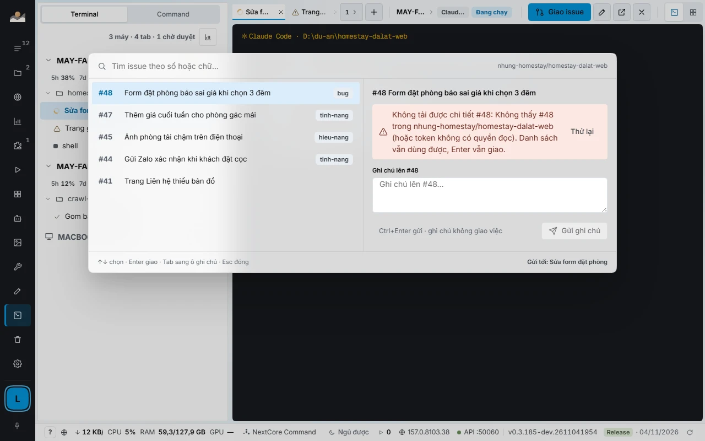

<div align="center">


# NextCore Browser

**A multi-profile browser with automation and AI agents, in one app for Windows, macOS and Linux.**

[](https://github.com/kennetvn/nextcore-browser-releases/releases/latest)
[](https://github.com/kennetvn/nextcore-browser-releases/releases)


[**Download**](#download) · [Features](#features) · [Use cases](#use-cases) · [For developers](#for-developers-and-ai-agents) · [Docs](https://docs.homestaynextcore.org/nextcore-browser/) · [Product page](https://homestaynextcore.org/nextcore-browser) · [Tiếng Việt](README.md)

</div>

---

> **This repository only holds installers, release notes and product documentation.** NextCore Browser is commercial, closed-source software. Every installer here is byte-identical to the one on [homestaynextcore.org](https://homestaynextcore.org/nextcore-browser); verify with the `SHA512SUMS` file attached to each release.

## The problem

Anyone who runs many accounts on the same website hits the same wall:

| Common problem | Result |
|---|---|
| One shared Chrome for every account | Cookies mix, constant logging out and back in |
| Juggling many windows and Chrome profiles | Wrong-account mistakes, no overview |
| A proxy that applies to the whole browser | No per-account network, no way to see which proxy died |
| Automation tools that start a blank browser every run | Login lost on every run, extra login steps to write |
| 2FA codes living on a phone or another app | Tens of seconds lost on every login |
| Repetitive work done by hand across dozens of accounts | Slow, hard to track what is finished |
| AI agents limited to one blank browser | Cannot hand work to many signed-in accounts at once |
| Claude Code, Codex, Gemini running on several machines, one window each | No idea which machine is doing what; an agent waits for you and nobody notices |
| One Claude account runs out of quota while another has plenty | The agent sits idle until reset, and the paid-for quota of the 5-hour window is wasted |

## The solution

**NextCore Browser** puts it all in one app:

- **One profile per account.** Each profile is its own Chromium browser with its own cookies, sessions, site data, extensions, proxy and fingerprint. Accounts stay signed in between runs.
- **One place to see and control everything.** The profile list shows live data: status, proxy, latency, 2FA code. Select many profiles and open, close, assign a proxy or tile the windows in one action.
- **Scripts for the repetitive part.** Chain steps into a script, run it across profiles, space the runs out, and pause for you where a decision is needed.
- **AI agents working alongside you.** The app ships an MCP server and a Local API. Claude Code, Cursor, VS Code, Antigravity or your own scripts create, open and drive profiles through them.
- **One place to run a whole team of agents.** NEXTCORE TERMINAL gathers every Claude Code, Codex, Gemini and Antigravity tab on every machine into one screen and balances quota across your own Claude accounts ([details](#nextcore-terminal-and-quota-balancing)).
- **Your data stays on your machine.** Profiles, cookies and 2FA keys live locally. Machines exchange work through a relay, never passwords, 2FA or cookies.

<div align="center">

<br><sub>Profile manager. Screenshot from the real app, sample data.</sub>
</div>

## NEXTCORE TERMINAL and quota balancing

If you run AI agents to write, test or operate software, this is the part of NextCore Browser worth the most attention. NCB **installs no agent of its own**: it uses the Claude Code, Codex, Gemini and Antigravity you already have, on the plans you already pay for, and handles the coordination around them.

<div align="center">

<br><sub>NEXTCORE TERMINAL. Machines, worktrees and tabs on the left; the selected tab's terminal on the right. Sample data.</sub>
</div>

### One screen for every tab on every machine

- **Machine, worktree, tab tree.** A spinner is an agent working, a tick an agent finished, a warning icon a tab waiting for your approval, a moon a sleeping machine.
- **Type into another machine's tab as if it were yours.** Your keystrokes appear instantly instead of waiting for the remote echo, and Vietnamese input methods (Unikey/EVKey) keep key order. Pasting an image (up to 10 MB) into a remote tab works too.
- **Hand a GitHub issue to an agent with one key** (`Alt+I`): type a number or a few words to filter, press Enter, and the tab receives "Work on issue #N: title, link" and starts. The panel shows the issue body, its checklist and the latest commit with CI status.
- **Every tab says what it runs:** engine (Claude, AGY, Codex, Gemini), model, reasoning level, account, and the remaining 5-hour and 7-day quota.
- **Split panes, a 2×2 grid, drag-reorder, and detach a tab into its own window.** Reopening the app returns you to the same machine, tab and layout.
- **Every machine measures itself.** NCB reads free RAM, CPU and app latency per machine to decide whether it can take another tab, always leaving room for you. Orphaned `node` processes left by closed tabs are cleaned every minute.
- **Keep machines awake, wake sleeping ones.** Worker machines stay awake while an agent is working; a sleeping machine can be woken over the LAN.

<div align="center">

</div>

### Balancing quota across your Claude accounts

Claude plans meter quota in 5-hour and 7-day windows. A window that resets after you used only 20% wastes the other 80%; conversely, one exhausted account stops an agent while another account sits unused. NCB treats **the quota of every account you signed in as one shared pool** and schedules it:

| When | What NCB does |
|---|---|
| An account's estimated quota **reaches 85%** | **Drain:** no new work for that account, close finished worker tabs, let working tabs finish their turn, then reopen them on the account with the most quota. |
| **95%** | **Switch now**, including working tabs: Claude resumes the same session on the new account, and NCB types "continue" into stuck tabs. No re-login. |
| A tab reports a limit for over 3 minutes | Switch to the account with the most quota left. |
| 2 or more accounts | Use the one **closest to its reset** first. Quota about to reset unused is wasted quota. |
| Stale numbers | Treated conservatively and marked `~`. An idle account whose number is over 30 minutes old is refreshed with one very small query. |
| **Every account exhausted** | NextCore Command **pauses itself and records when it will resume** (reset time plus 3 minutes), then rereads quota and types "continue" into stuck tabs. |

<div align="center">

<br><sub>Accounts and quota for one machine: 5-hour and 7-day quota, reset times, 85% / 95% forecast, and the "Auto-switch at limit" toggle.</sub>
</div>

Also:

- **Quota is estimated from the whole team's burn rate.** Every machine reports each account's quota through the relay every 30 seconds; NCB merges by email, estimates how many % per hour each tab burns, and switches **before** the limit instead of waiting for an error.
- **Usage screen: the shared pool.** Four numbers (what is left, current pace, forecast of running out, next reset), a 7-day chart with measured and planned lines, an "use it or lose it" account table, and quota history by job, tab and machine. **Apply plan** runs a scheduling pass immediately.
- **Quota-harvest reports built from real numbers:** which account used how much, how much was lost (with tab-hours and the machines that used it), and concrete proposals: switch a machine's account, raise the tab count, load more work. Each proposal shows the extra % of quota it would use. A figure that cannot be measured is left out, never guessed.
- **Fallbacks when Claude plans run dry:** if the main machine has Antigravity (`agy`), NextCore Command moves there temporarily and returns to Claude once quota recovers to 20%. For worker tabs you can enable your own Anthropic API key: **off by default**, capped at **3 USD per job and 15 USD per day**, and not switchable by agents over MCP, so no agent can spend your money on its own.
- **Three tab groups:** doing work (50%), exploring for work worth doing (30%), reserve for acceptance and unblocking (20%). The split adapts to the backlog, and slots are never left idle when another group has work.

> This balances across **your own** accounts and plans. NCB adds no quota, uses nobody else's accounts, and does not change any provider's limits.

### NextCore Command: one conductor for the team

Each NextCore account has exactly **one** NextCore Command, on the main machine. It reads each worker tab's **handover** when a job finishes or gets stuck, accepts it (pass, send back, or record a question for you), splits big jobs into smaller ones in the task book, and writes every decision as a log line you can reread.

- **It does not run continuously.** With no event it sits idle and spends no tokens. Events that arrive close together are batched into one wake-up.
- **It does not do what it should not:** it does not write code in place of the worker tab, enter OTP codes, pay, change prices or make business decisions. Anything that needs you becomes a question with a suggested option.
- **A broken tab is rebuilt automatically.** If the Command tab is closed, its session expires or it hits a limit, NCB closes it and opens a new one; the tracked work and the log live inside NCB, so nothing is lost.
- **Model chosen by difficulty,** lowered when a job is running late, and stopped at the spend cap.

<div align="center">

</div>

Guides: [NEXTCORE TERMINAL](https://docs.homestaynextcore.org/nextcore-browser/nextcore-terminal/) · [Relay and multi-machine](https://docs.homestaynextcore.org/nextcore-browser/tram-nhieu-may/).

## Use cases

| Who | What they do with it |
|---|---|
| **Sellers with several shops and channels** | One signed-in profile per shop. Open the right shop without cookies leaking between shops. |
| **Customer-support teams** | One profile per agent and channel. Tile many windows on a second screen to watch them together. |
| **Agencies and content-operations teams** | Manage pages and community groups for many clients, one account set per client. Posting scripts run on a schedule, spaced between groups, with per-group results. |
| **Market research and group data** | A local group store records member counts and posting rhythm. Filter by region, size and rhythm. |
| **QA and web testing** | One profile per user role. Playwright or Puppeteer attach to a profile over CDP. Measure UI at several device widths with the built-in e2e suite. |
| **Developers using AI agents** | Let Claude Code, Cursor or Antigravity create, open and drive many signed-in profiles instead of a blank browser each run. |
| **Software teams running many agents** | NEXTCORE TERMINAL runs Claude Code, Codex, Gemini and Antigravity in the app's tabs. NextCore Command hands GitHub issues to idle tabs, accepts handovers, and [balances quota](#nextcore-terminal-and-quota-balancing) across your Claude accounts so agents do not stall mid-job. |
| **Design teams** | NEXTCORE DESIGN lets several agents draw in parallel, 20 cells per screen (5 states × 4 widths), export PNG or SVG, and share a view link with people who do not have the app. |

> You are responsible for following the terms of the websites you use. NextCore Browser is a management tool and does not change any platform's rules.

## Features

The app has **24 modules** in four groups. Full list and guides in the [docs](https://docs.homestaynextcore.org/nextcore-browser/).

**Browser:** profiles and proxy (HTTP, HTTPS, SOCKS4, SOCKS5) · browser fingerprint (seeded per profile; timezone, language and location follow the proxy IP) · bulk actions · window tiling across monitors · shared proxy store with GB and cost per period · 2FA codes on the row · encrypted `.ncbak` backups (AES-256) · per-profile VPN where a dead node blocks opening so the real IP never leaks.

**Data and customers:** NEXTCORE GROUPCRAWL (local group store with member counts, posting rhythm and each profile's role) · NEXTCORE CUSTOMERPOST (reads posts from customers looking for rooms in Facebook groups) · NEXTCORE CRM, SHEET and PMS (open inside the app, signed in to the right NextCore account).

**Automation:** NEXTCORE AUTOMATIONS (scripts across profiles, schedule or run by hand, record actions on one profile and replay on another) · NEXTCORE AGENT (connect your API keys for Anthropic, OpenAI, Gemini and a dozen more, ordered into a fallback chain) · NEXTCORE MEDIA (images, video and short films using the free quota of signed-in AI-service profiles) · NCB COMMAND (hand work to a team of agents by GitHub issue number).

**For developers:** Local API + CDP · MCP · NEXTCORE TERMINAL · NCB_E2E · NEXTCORE DESIGN.

**Coming:** profile sync across machines · scheduled script runs · multi-user teams with permissions and an audit log of who opened which profile.

## Multi-machine

Machines on the same NextCore account see each other through a relay on the local network, with no port opened to the Internet. Pick one **main machine**; the others take work from it.

<div align="center">

</div>

- See every tab on every machine at once: running, waiting for your approval, quota exhausted.
- Hand the main-machine role to another machine with one button in Settings.
- If the app crashes or is killed, it reopens itself within seconds and restores the running profiles.
- Passwords, 2FA, OTP and cookies never pass through the relay.

## For developers and AI agents

```bash
# Open a profile and get a wsEndpoint for Playwright
curl -X POST -H "Authorization: Bearer $NCB_TOKEN" \
  http://127.0.0.1:19880/api/v1/profiles/p_7f3a/start
```

```json
{ "pid": 18244, "debugPort": 52144,
  "wsEndpoint": "ws://127.0.0.1:52144/devtools/browser/9c1e…" }
```

- **MCP built in.** Agents connect to `http://127.0.0.1:<port>/mcp` with a token. Nothing is exposed to the Internet.
- **One-click setup** for Claude Code, Cursor, VS Code and Antigravity: the app writes the config file with a separate token per assistant.
- **Page control with `browser_*`**, the same tool names as the official Playwright MCP, so agents already know them.
- **One MCP session per profile.** Open more sessions to run profiles in parallel; a profile held by one session is refused to another, so two agents never step on each other.

Docs: [Local API](https://docs.homestaynextcore.org/developer/local-api/) · [MCP for AI agents](https://docs.homestaynextcore.org/developer/mcp/).

## Security and privacy

- Profile data stays on your machine. `.ncbak` backups use AES-256.
- Local API and MCP listen on `127.0.0.1` only, with one token per machine.
- The multi-machine relay does not carry passwords, 2FA, OTP or cookies.
- The app must reach `homestaynextcore.org` at least once every 3 days to keep your session.
- Update manifests (`latest*.yml`) carry an ed25519 signature. Verify downloads with `SHA512SUMS`.
- Report vulnerabilities as described in [SECURITY.md](SECURITY.md).

## Download

**Latest: 0.3.191** (2026-11-12). Get the installers and `SHA512SUMS` from the [Releases page](https://github.com/kennetvn/nextcore-browser-releases/releases/latest).

| Platform | File | Size |
|---|---|---|
| **Windows** 10 and 11, 64-bit | `Setup.exe` installer | about 145 MB |
| **Windows** portable | `Portable.exe`, no install | about 145 MB |
| **macOS** Apple Silicon (M1 to M4) | `mac-arm64.dmg` | about 163 MB |
| **macOS** Intel | `mac-x64.dmg` | about 171 MB |
| **Linux** (Ubuntu, Debian), version 0.3.190 | `AppImage` and `.deb` | about 134 to 179 MB |

**Install in three steps, about two minutes:** download the installer; run it (if Windows shows the blue "Windows protected your PC" screen, choose *More info*, then *Run anyway*); sign in to NextCore: the app shows an 8-character code, approve it on [homestaynextcore.org](https://homestaynextcore.org). During the beta there is no limit on the number of machines. A free trial is available before you pick a plan. The app downloads updates itself and applies them when you restart.

## Support

- **App bugs and suggestions:** [open an issue](https://github.com/kennetvn/nextcore-browser-releases/issues/new/choose) with the app version and OS. Never paste passwords, tokens or 2FA keys.
- **Account and plan questions:** contact us through [homestaynextcore.org](https://homestaynextcore.org).
- **Security vulnerabilities:** see [SECURITY.md](SECURITY.md); do not post publicly.

## License

NextCore Browser is commercial, **closed-source** software, used under the [Terms of Use](https://homestaynextcore.org/terms). Details in [LICENSE.md](LICENSE.md).

---

<div align="center">
<sub>© 2026 NextCore · <a href="https://homestaynextcore.org/nextcore-browser">homestaynextcore.org/nextcore-browser</a></sub>
</div>
