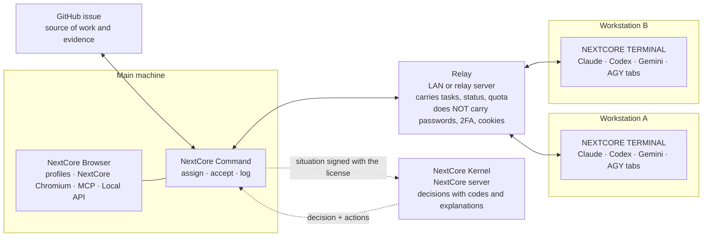
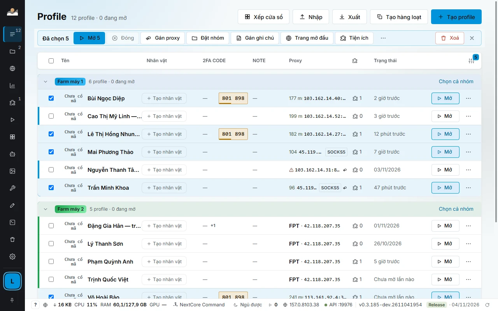
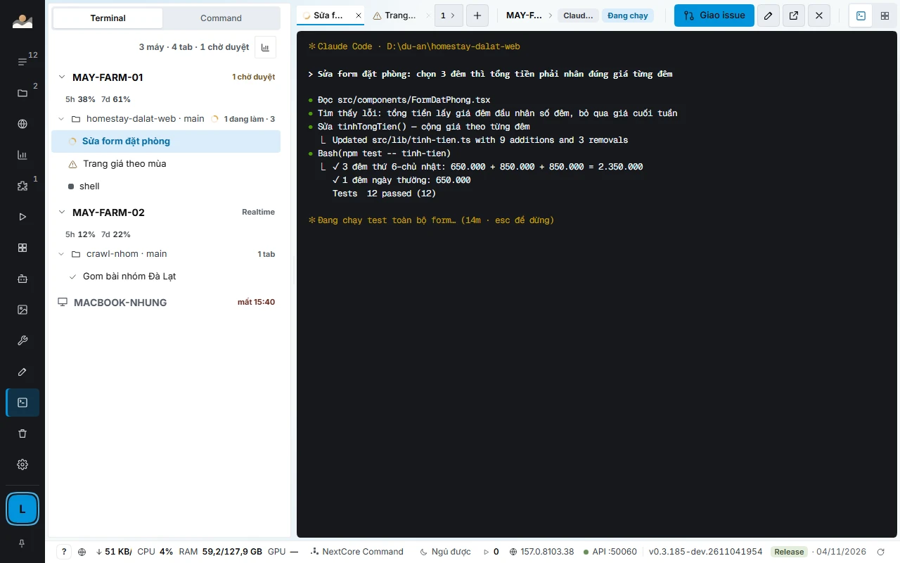
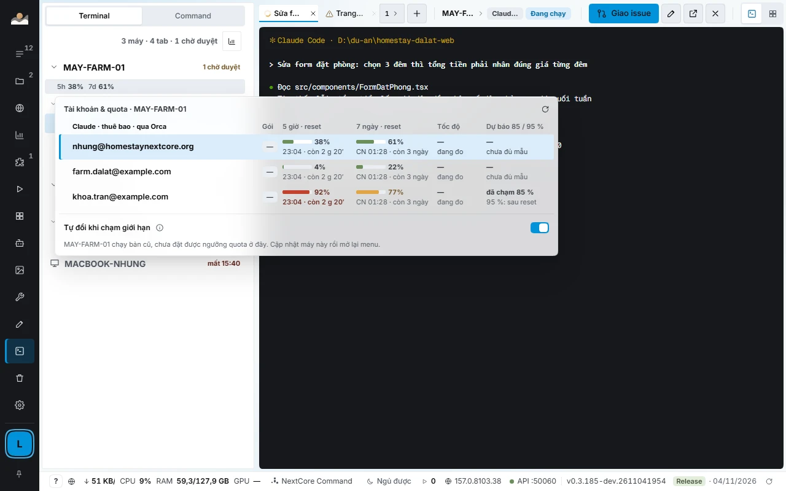
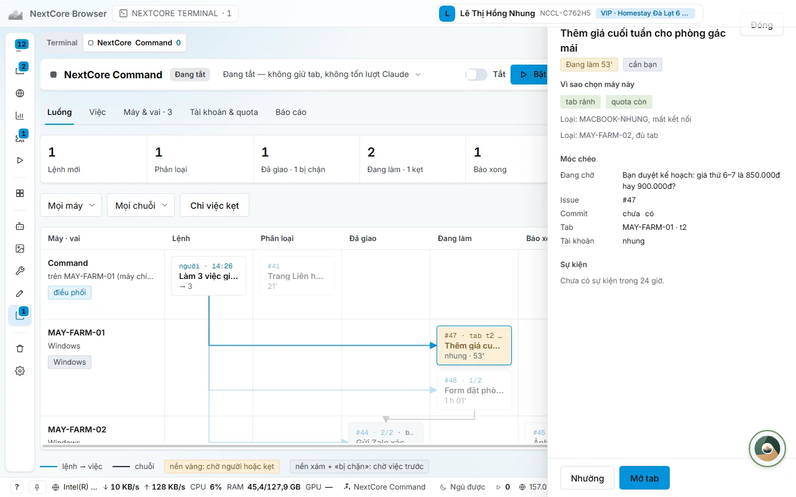
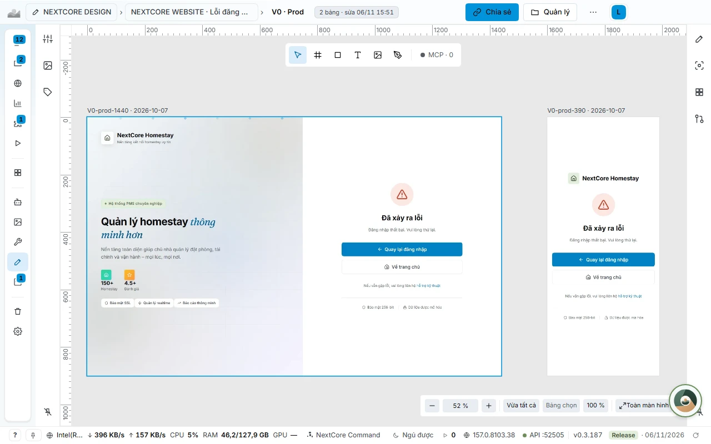

<div align="center">


# NextCore Browser

**A workspace for people and AI agents: isolated multi-profile browsers, an agent team orchestrated across machines, and interfaces drawn before any code is written.**

[](https://github.com/kennetvn/nextcore-browser-releases/releases/latest)
[](https://github.com/kennetvn/nextcore-browser-releases/releases)


[**Download**](#download) · [Six pillars](#six-pillars) · [Architecture](#architecture) · [NCB Mobile](#ncb-mobile-in-development) · [Real-world use](#real-world-use) · [Comparison](#comparison) · [FAQ](#faq) · [Docs](https://docs.homestaynextcore.org/nextcore-browser/) · [Tiếng Việt](README.md)

</div>

---

> **This repo only contains installers, release notes and introductory docs.** NextCore Browser is commercial, closed-source software. The installers here are byte-for-byte identical to the ones on [homestaynextcore.org](https://homestaynextcore.org/nextcore-browser); verify them with the `SHA512SUMS` file attached to each release.

## What NextCore Browser is

An app for Windows, macOS and Linux with three layers working together:

1. **Browser layer.** Each account runs in its own profile: its own NextCore Chromium, its own stable fingerprint, its own proxy or VPN. Dozens or hundreds of accounts run on one machine without touching each other.
2. **Agent orchestration layer.** Claude Code, Codex, Gemini and Antigravity run in the app's tabs, across multiple machines, on one screen. NextCore Command assigns and accepts work, quota balancing keeps agents from standing idle, and NextCore Kernel is the brain that makes decisions.
3. **Developer tooling layer.** MCP and a Local API let agents or scripts control everything in the app; NextCore E2E measures web pages on logged-in profiles; NEXTCORE DESIGN draws interfaces before any code is written.

<div align="center">

<br><sub>Profile management. Screenshot from the real app, sample data.</sub>
</div>

## Six pillars

<table>
<tr>
<td width="33%" valign="top">

### 1. Isolated browsers
**NextCore Chromium**, a stable fingerprint per profile, its own proxy and VPN, 2FA codes right on the row, encrypted backups.

[Read more →](docs/en/browser-fingerprint.md)

</td>
<td width="33%" valign="top">

### 2. Automation and data
Scripts that run across many profiles, a local group store, reading real customer posts, CRM, image and video generation.

[Read more →](#2-automation-and-data)

</td>
<td width="33%" valign="top">

### 3. NEXTCORE TERMINAL
Every agent tab on every machine on one screen; assign a GitHub issue with one key; balance quota across Claude accounts.

[Read more →](docs/en/terminal-command-quota.md)

</td>
</tr>
<tr>
<td width="33%" valign="top">

### 4. NextCore Command
One commander for the whole team: reads Handoffs, accepts work against evidence, splits tasks, keeps a log, rebuilds itself when it breaks.

[Read more →](docs/en/terminal-command-quota.md#nextcore-command-one-commander-for-the-whole-team)

</td>
<td width="33%" valign="top">

### 5. NextCore Kernel and E2E
A decision-making brain with codes and explanations; UI testing on real profiles that never reports green when nothing was tested.

[Read more →](docs/en/kernel-e2e.md)

</td>
<td width="33%" valign="top">

### 6. NEXTCORE DESIGN
Many agents draw in parallel, 20 cells per screen (5 states × 4 device widths), import from Penpot, Figma, Sketch, then write code.

[Read more →](docs/en/design.md)

</td>
</tr>
</table>

## The problem

| What you are doing | Where it gets stuck |
|---|---|
| Managing many accounts on the same site | One shared Chrome mixes cookies; Chrome profiles separate data but still share hardware and a single proxy |
| Each account needs its own network path | A proxy is set for the whole browser, you can't tell which proxy is down, traffic isn't counted |
| Automating repetitive work | Tools open a blank browser on every run, logins are lost, 2FA codes live on your phone |
| Handing work to AI agents | Agents can only drive a blank browser, not work across many logged-in accounts |
| Running agents on many machines | One terminal window per machine, no idea which machine is doing what, agents stuck waiting for you and nobody sees it |
| Using several Claude accounts | One account runs out of quota and agents stand still while another account has plenty left; when a 5-hour window refreshes at only 20% used, 80% of the paid quota is wasted |
| Trusting an agent's «done» | You have to re-check every task yourself, because agents often report done and green too early |
| Building interfaces with agents | The agent writes code right away, and only afterwards you see it missed the intent; error, empty and loading states are missing; it breaks on small screens |

## Architecture



- **Data stays on your machine.** Profiles, cookies and 2FA keys live on the machine. The relay only carries tasks, status and quota.
- **Each NextCore account has exactly one NextCore Command**, placed on the main machine. Workstations receive work from the main machine.
- **Kernel runs on the NextCore server,** bound to the license and the device key; the installer carries no rules.

## 1. Isolated browsers

One profile per account, and each profile isolates three layers at once:

| Layer | Isolated by |
|---|---|
| **Data** | Its own Chromium data folder: cookies, logins, Local Storage, IndexedDB, extensions |
| **Network** | Its own proxy (HTTP, HTTPS, SOCKS4, SOCKS5) or its own VPN node, with liveness checks and latency measurement |
| **Browser identity** | Its own fingerprint, stable between launches |

- **NextCore Chromium:** the official Chromium build for automation, downloaded and managed by the app, branded as NextCore, with a CDP port ready.
- **Stable fingerprint:** each profile gets a seed; screen, graphics card, CPU cores, RAM, Canvas, WebGL, audio and fonts are derived from it, so every launch looks like the previous one. Time zone, language and location match the proxy IP. User-Agent and Client Hints match the exact Chromium build that is running. All of it is set before the page runs its first line of script, including new tabs, popups and iframes.
- **VPN store:** if a node has no connectivity, the profile does not open, so the real IP is never exposed.
- **Proxy store:** one proxy shared by many profiles, GB and cost counted per period, routing by domain to save traffic.
- **2FA codes on the profile row**, AES-256 encrypted `.ncbak` backups, credential masking, multi-monitor window arrangement, bulk operations.

<div align="center">

</div>

Details, examples and limits: [**NextCore Chromium, fingerprints and profile isolation**](docs/en/browser-fingerprint.md).

## 2. Automation and data

| Module | What it does |
|---|---|
| **NEXTCORE AUTOMATIONS** | Scripts that run across many profiles. Combine steps into flows, run them on a schedule or by hand, see where each step is, and pause for you at the points that need a decision. Record actions on one profile as a flow and replay it on another. |
| **NEXTCORE GROUPCRAWL** | A local group store with metrics: members, posting rhythm, each profile's role in the group. Filter by region, size, posting rhythm. |
| **NEXTCORE CUSTOMERPOST** | Reads posts from customers looking for rooms in Facebook groups, crawls on its own using your profiles, filters by time, area, category and room-offer comments. |
| **NEXTCORE CRM, SHEET, PMS** | Opens the CRM inbox, the room schedule sheet and the operations screen right in the app, signs in to the right NextCore account automatically, with the web session separate from every profile. |
| **NEXTCORE AGENT** | Connects your API keys to Anthropic, OpenAI, Gemini and more than a dozen other providers, orders them into a fallback chain, and shows models, prices, limits and recent calls. |
| **NEXTCORE MEDIA** | Generates images, videos and short films using the free allowances of profiles logged in to AI services, with an AI Director that writes scenes and sizes per platform. |
| **NEXTCORE TOOLS** | Bulk video download, channel scanning, stream link capture, speech extraction, e-commerce product fetching, conversion, metadata removal. Everything runs on this machine. |
| **NEXTCORE EXTENSIONS, GROUPINVEST** | A set of browser extensions and group tools bundled in the app. |

> You are responsible for complying with the terms of the sites you use. Automation on platforms may violate those platforms' terms; NextCore Browser is a management tool and does not change any platform's rules.

## 3. NEXTCORE TERMINAL and quota balancing

NCB **installs no agent**: it uses the Claude Code, Codex, Gemini and Antigravity you already installed and the plans you already bought, and handles the orchestration around them.

<div align="center">

<br><sub>Machine tree, worktrees and tabs on the left; the selected tab's terminal on the right. Sample data.</sub>
</div>

- **One screen for every tab on every machine.** A spinner is an agent working, a check mark is done, a warning is waiting for your approval, a moon is a machine asleep. Type into another machine's tab as if it were your own, and the text appears immediately.
- **Assign a GitHub issue with one key** (`Alt+I`). The tab receives «Work on issue #N: title, link» and starts working.
- **Each tab states what it runs:** engine, model, reasoning level, account, and remaining quota for the 5-hour and 7-day windows.
- **Quota is one shared pool.** From 85% it drains gradually, from 95% it switches accounts immediately while Claude continues the same session, using first the account closest to its refresh time. When every account is exhausted, Command stops by itself and resumes after the reset time.
- **Fallbacks:** Antigravity when the Claude plan runs out; your own Anthropic API key for worker tabs, **off by default**, capped at 3 USD per task and 15 USD per day.
- **Each machine measures its own capacity** (RAM, CPU, latency) to decide whether to accept more tabs, keep the machine awake, and wake sleeping machines over the LAN.

<div align="center">

<br><sub>Accounts and quota for one machine, with threshold forecasts and the auto-switch toggle.</sub>
</div>

> This is balancing across **your own** accounts and plans. NCB adds no quota, uses no one else's accounts, and does not change the provider's limits.

Details: [**NEXTCORE TERMINAL, NextCore Command and quota balancing**](docs/en/terminal-command-quota.md).

## 4. NextCore Command

Each NextCore account has exactly **one** NextCore Command, placed on the main machine. It is the commander of the agent team:

| What it does | What it does not do |
|---|---|
| Reads the worker tab's **Handoff** when work is done or stuck | Write code in place of the worker tab |
| Accepts work: pass, reassign, or write a question for you | Enter OTP codes, pay money, change selling prices, or make business decisions for you |
| Splits big tasks into small ones, assigns the right machine and tab | Run when you have turned it off or paused it |
| Writes each decision as one log line for you to reread | Type into a tab you are using |

With no events, Command sits idle and **costs no tokens**. If the Command tab breaks it is rebuilt automatically; the tasks it tracks and the log live in NCB, so nothing is lost.

<div align="center">

</div>

## 5. NextCore Kernel and NextCore E2E

**NextCore Kernel** is the operating knowledge that runs inside NCB, the brain of NextCore Command and NextCore E2E. It is not in the installer and does not write into your repo.

- **Every decision has a stable code and an explanation:** for example `accepted` (acceptance passed), `kept-session` (keep the live session), `parked-for-release` (waiting for a release), with a sentence saying what was considered and what was concluded.
- **Learns from real outcomes:** after 24 hours and 7 days, the app records whether the work passed, was reassigned, was reopened or was falsely reported done; it sends only codes, action groups and measurements, never free text.
- **Designed for real operation:** bound to the license and device key, tolerates up to 24 hours offline, has a call cap, and thresholds adjustable remotely every 5 minutes.

**NextCore E2E** measures your web pages **on real, already logged-in profiles**, with no need to set up test accounts: many screen widths × light/dark × touch screen × slow network; horizontal overflow, clipped text, small tap targets, contrast, console errors, security headers; Lighthouse; SEO and readiness for AI search engines; compare who sees what across roles; run multi-step scenarios and record video. **It never reports green when nothing was tested:** empty scenarios, identical screenshots, selectors that match nothing, and a running build that does not yet contain the commit under test are all rejected.

Details: [**NextCore Kernel and NextCore E2E**](docs/en/kernel-e2e.md).

## 6. NEXTCORE DESIGN

The interface drawing store lives right inside NCB. Many agents draw in parallel through the `ncd_*` MCP, you review and comment on the drawing, and only then is code written to match the drawing exactly.

<div align="center">

<br><sub>A page just imported from a Penpot file, with the 1440 and 390 boards in the right positions.</sub>
</div>

- **20 cells per screen:** 5 states (empty, loading, hover and focus, error, success) × 4 widths (390, 768, 1280, 1920). `ncd_check` reports missing cells and colors outside the tokens.
- **Many agents, nobody overwrites anybody:** a board being edited by an agent is locked, showing the agent's name and when it will be released.
- **Import from Penpot, Figma, Sketch, Adobe XD, PDF, HTML, SVG, claude.ai artifacts.** Penpot import matches position and size within ±1 px (measured on 3,300 real boards: 0 boards off), and the 6-step Migrate wizard includes a Review step using SSIM similarity of 0.95 or higher, read-only toward the source.
- **Export PNG, SVG and send a view link** to people without the app.
- The NextCore team's store (03/11/2026): **297 drawings, 3,231 boards**.

Details: [**NEXTCORE DESIGN**](docs/en/design.md).

## For developers

```bash
# Mở profile, nhận wsEndpoint cho Playwright
curl -X POST -H "Authorization: Bearer $NCB_TOKEN" \
  http://127.0.0.1:19880/api/v1/profiles/p_7f3a/start
```

- **Local API and CDP:** Playwright and Puppeteer connect straight to a profile. Listens only on `127.0.0.1`, with a separate token per machine.
- **MCP built into the app:** nearly 190 tools, with smaller sets for clients that limit the number of tools (`?bo=app` 127 tools, `?bo=co-ban` about 50). One-click connection for Claude Code, Cursor, VS Code, Antigravity.
- **`browser_*` has the same names as the official Playwright MCP,** so an agent that already knows it can use it right away. One MCP session per profile, so two agents never step on each other.

Details: [**Local API, CDP and MCP**](docs/en/developer.md).

## NCB Mobile (in development)

> **Not publicly released yet.** Test builds will ship through TestFlight (iOS) and an APK (Android); when they exist, the links will appear on the [Releases](https://github.com/kennetvn/nextcore-browser-releases/releases) page.

An iPhone and Android app so you do not have to sit at the main machine to know what your agent team is doing:

- **See machines and quota:** each machine's state, the 5-hour and 7-day quota of every Claude account, the tabs currently working.
- **Chat with NextCore Command** (text and images) and get push notifications for new messages.
- **Control terminals remotely:** open tabs, view the screen, type commands, and **approve permission prompts** when an agent asks. The Terminal screen has a key row built for fingers (sticky Ctrl and Alt, raw keys such as Ctrl-C).
- **Assign work, read the task book, answer your inbox:** anything that needs your decision shows up as a question with options you tap to choose.
- **Security:** pairing by QR code plus a short comparison code, end-to-end AES-GCM encryption through the relay (push notifications carry ciphertext only), a separate revocable device token, a permission level for the phone.

Built with Capacitor 8 and React, following NEXTCORE DESIGN drawings. Details: [**NCB Mobile**](docs/en/mobile.md).

## Real-world use

| Who uses it | What they do with NextCore Browser |
|---|---|
| **Sellers with many stores and channels** | One logged-in profile per store, with no cookie mixing between stores. |
| **Customer support teams** | One profile per employee and per channel. Arrange many windows in a grid on a second monitor to watch them all at once. |
| **Agencies and content operations teams** | Manage the pages and community groups of many clients, with accounts separated per client. Posting scripts run on a schedule, paced out, with results reported per group. |
| **Market research, reading group data** | The local group store records member counts and posting rhythm; filter by region, size and posting rhythm to choose where to work. |
| **QA and web testing** | One profile per user role; Playwright or Puppeteer connect over CDP; NextCore E2E measures many device widths, light and dark, slow networks. |
| **Developers using AI agents** | Let Claude Code, Cursor or Antigravity create, open and control many logged-in profiles instead of a blank browser on every run. |
| **Development teams with many agents** | NEXTCORE TERMINAL runs many agents on many machines; Command assigns GitHub issues and accepts Handoffs; quota balancing across Claude accounts keeps agents from stopping midway. |
| **Interface design teams** | NEXTCORE DESIGN lets many agents draw in parallel with every state and device width, import old drawings, and send view links. |

## Comparison

| | Playwright MCP only | One Chrome, many profiles | NextCore Browser |
|---|---|---|---|
| Keeps logins between runs | No, a fresh browser every time | Yes | Yes |
| Own proxy per account | No | No, one proxy for the whole browser | Yes, per profile, with proxy checks |
| Own stable fingerprint per account | No | No, shared hardware | Yes, its own seed per profile |
| Agent creates and manages profiles | No | No | Yes, via MCP |
| Many agents on different accounts at once | One browser per server | Cookies easily mix between accounts | Yes, one session per profile |
| Orchestrates an agent team across machines | No | No | Yes, NEXTCORE TERMINAL and NextCore Command |
| Quota balancing across Claude accounts | No | No | Yes, a shared quota pool |
| Testing on logged-in profiles | You must set up test accounts | By hand | Yes, NextCore E2E |
| Runs only on your machine | Yes | Yes | Yes, MCP listens only on 127.0.0.1 |

## Security and privacy

- **Data stays on your machine.** `.ncbak` backups are AES-256 encrypted.
- **The Local API and MCP listen only on `127.0.0.1`,** one token per machine, and one separately revocable token per assistant.
- **The multi-machine relay does not carry passwords, 2FA, OTP or cookies.**
- **Credential masking:** an agent reads a single cell verbatim only through a dedicated command, one cell at a time, and every call is logged. No tool returns a proxy password.
- **The Anthropic API key never goes into commands, files or logs;** it goes only into that tab's environment variables. An agent over MCP cannot turn on the API-key mode.
- **The installer carries no Kernel rules;** when a machine is revoked, its key is deleted.
- The app must connect to `homestaynextcore.org` at least once every 3 days to keep the sign-in session.
- The update lists (`latest*.yml`) carry an ed25519 digital signature. Verify downloads with `SHA512SUMS`.
- Report security vulnerabilities as described in [SECURITY.md](SECURITY.md).

## Download

**Latest release: 0.3.192** (14/11/2026). Get the installers and the `SHA512SUMS` file from the [Releases page](https://github.com/kennetvn/nextcore-browser-releases/releases/latest).

| Platform | File | Size |
|---|---|---|
| **Windows** 10 and 11, 64-bit | `Setup.exe` installer | about 145 MB |
| **Windows** Portable | `Portable.exe`, no installation needed | about 145 MB |
| **macOS** Apple Silicon (M1 to M4) | `mac-arm64.dmg` | about 163 MB |
| **macOS** Intel | `mac-x64.dmg` | about 171 MB |
| **Linux** (Ubuntu, Debian), version 0.3.190 | `AppImage` and `.deb` | about 134 to 179 MB |

Windows farm machines can download and install with one PowerShell line, with no warning screen:

```powershell
curl.exe -L -o "$env:TEMP\ncb-setup.exe" https://homestaynextcore.org/downloads/nextcore-browser/moi-nhat/windows; & "$env:TEMP\ncb-setup.exe"
```

**Install in three steps, about two minutes:**

1. **Download the installer** from the table above.
2. **Install.** If you downloaded it with a browser, Windows may show the blue «Windows protected your PC» screen: click *More info*, then *Run anyway*.
3. **Sign in to NextCore.** The app shows an 8-character code; click *Allow* on [homestaynextcore.org](https://homestaynextcore.org). During the beta there is no limit on the number of machines.

| Requirement | |
|---|---|
| Windows | 10 or 11, 64-bit |
| macOS | Apple Silicon and Intel |
| Linux | AppImage, Ubuntu or Debian |
| Memory | Depends on how many profiles are open at once; the app footer shows RAM in yellow above 70% and red above 90% |
| Account | An active NextCore account; free trial before choosing a plan |

The app downloads new versions automatically and updates when you restart it. See [CHANGELOG.md](CHANGELOG.md) or the [Releases](https://github.com/kennetvn/nextcore-browser-releases/releases) page.

## FAQ

<details>
<summary><b>Does NextCore Browser come with AI agents installed?</b></summary>

No. NCB uses the Claude Code, Codex, Gemini and Antigravity you already installed and the plans you already bought. What NCB does is orchestration: display, assigning work, acceptance, quota balancing.
</details>

<details>
<summary><b>Where is profile data stored? Does it go to a server?</b></summary>

Profiles, cookies and 2FA keys live on your machine. The multi-machine relay only carries tasks, status and quota, not passwords, 2FA, OTP or cookies. The NextCore server computes Kernel decisions and manages sign-in and licenses.
</details>

<details>
<summary><b>What happens if I lose the network?</b></summary>

Kernel decisions keep running from the copy saved on the machine for up to 24 hours. Past that, NextCore Command and NextCore E2E report unavailable until the network is back. The app must connect to `homestaynextcore.org` at least once every 3 days to keep the sign-in session.
</details>

<details>
<summary><b>Does quota balancing violate the AI providers' terms?</b></summary>

NCB only balances across your own accounts and plans: it adds no quota, uses no one else's accounts and does not change the provider's limits. You are still responsible for reading and complying with each provider's terms.
</details>

<details>
<summary><b>Will an agent spend my money on its own?</b></summary>

No. The Anthropic API key mode is **off by default**, can only be turned on in the app's settings (an agent over MCP cannot turn it on), and is capped at 3 USD per task and 15 USD per day. Command does not pay money, enter OTP codes, change selling prices or make business decisions for you.
</details>

<details>
<summary><b>Can I use another browser instead of NextCore Chromium?</b></summary>

Yes, but only as a secondary option. A profile opened with an installed Chrome, Edge, Brave, Cốc Cốc or Firefox cannot run NextCore's scripts, extensions and automation, and the app warns you right on the profile row.
</details>

<details>
<summary><b>Is automation on Facebook or other platforms safe?</b></summary>

Automation on platforms may violate those platforms' terms. NCB does not change any platform's rules. Have the agent stop and ask for your approval before public actions such as posting, mass messaging or payments.
</details>

<details>
<summary><b>Can I use NextCore Kernel separately for another project?</b></summary>

You may use NextCore Command and NextCore E2E for your own work, on your own repos. Kernel may only be applied, not extracted or distilled: do not read, copy or reverse-engineer the rules, prompts or scoring methods. See [LICENSE.md](LICENSE.md).
</details>

<details>
<summary><b>Pricing and plans?</b></summary>

There is a free trial before choosing a plan; during the beta there is no limit on the number of machines. For plan details see [homestaynextcore.org](https://homestaynextcore.org/nextcore-browser).
</details>

## Roadmap

**Available now (24 modules, version 0.3.192)**
Browser: Profiles and proxy, Browser fingerprint, Bulk operations, Window arrangement, PROXY STORE, 2FA codes, Backup, VPN STORE · Data and customers: GROUPCRAWL, CUSTOMERPOST, CRM · Automation: AUTOMATIONS, AGENT, MEDIA, NCB COMMAND · For developers: Local API + CDP, MCP, NEXTCORE TERMINAL, NCB_E2E, NEXTCORE DESIGN · Also in the app: EXTENSIONS, TOOLS, GROUPINVEST.

**Coming next**
- Profile sync across machines
- Script schedules by hour, by day, by work shift
- Multi-person teams: permissions per profile group, a log of who opened which profile
- **NCB Mobile** for iPhone and Android: test builds through TestFlight and APK ([details](docs/en/mobile.md))

## Documentation

| | |
|---|---|
| [NextCore Chromium, fingerprints](docs/en/browser-fingerprint.md) | Profile isolation, fingerprints, proxy, VPN |
| [NEXTCORE TERMINAL, Command, quota](docs/en/terminal-command-quota.md) | Agent orchestration, quota balancing, multiple machines |
| [NextCore Kernel and E2E](docs/en/kernel-e2e.md) | The decision-making brain and testing on real profiles |
| [NEXTCORE DESIGN](docs/en/design.md) | Draw first, code later |
| [Local API, CDP, MCP](docs/en/developer.md) | Control by script and AI agent |
| [NCB Mobile](docs/en/mobile.md) | iPhone and Android app (in development) |
| [Full guide](https://docs.homestaynextcore.org/nextcore-browser/) | Each module, troubleshooting |

## Support

- **App bugs and feedback:** [open an issue](https://github.com/kennetvn/nextcore-browser-releases/issues/new/choose) with the app version and operating system. Do not paste passwords, tokens or 2FA keys.
- **Account and plan support:** contact us via [homestaynextcore.org](https://homestaynextcore.org).
- **Security vulnerabilities:** see [SECURITY.md](SECURITY.md), do not post them publicly.

## License

NextCore Browser is commercial software, **closed source**. The installers in this repo may only be used under NextCore's [Terms of Use](https://homestaynextcore.org/terms). No reverse engineering, no extraction, no using the app's output to build competing products. Details in [LICENSE.md](LICENSE.md).

---

<div align="center">
<sub>© 2026 NextCore · <a href="https://homestaynextcore.org/nextcore-browser">homestaynextcore.org/nextcore-browser</a></sub>
</div>
