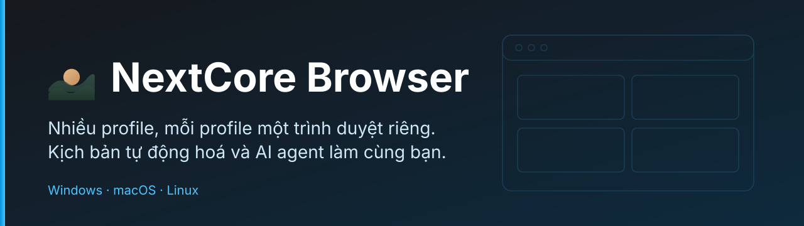
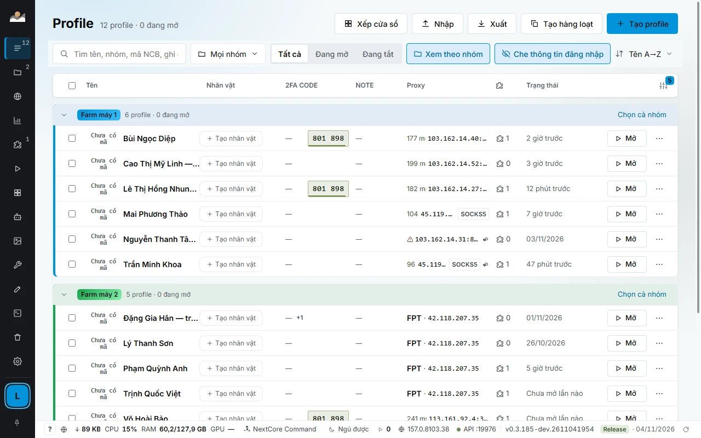
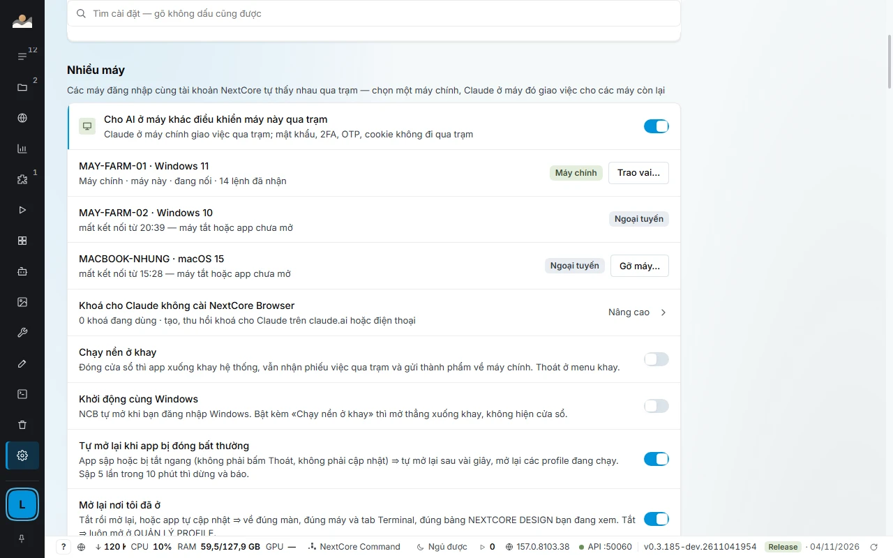

<div align="center">



# NextCore Browser

**Trình duyệt nhiều profile, tự động hoá và AI agent, trong một app cho Windows, macOS và Linux.**

[](https://github.com/kennetvn/nextcore-browser-releases/releases/latest)
[](https://github.com/kennetvn/nextcore-browser-releases/releases)


[**Tải về**](#tải-về) · [Tính năng](#tính-năng) · [Ứng dụng thực tế](#ứng-dụng-thực-tế) · [Cho developer](#cho-developer-và-ai-agent) · [Tài liệu](https://docs.homestaynextcore.org/nextcore-browser/) · [Trang sản phẩm](https://homestaynextcore.org/nextcore-browser) · [English](README.en.md)

</div>

---

> **Repo này chỉ chứa bản cài đặt, ghi chú phát hành và tài liệu giới thiệu.** NextCore Browser là phần mềm thương mại, mã nguồn đóng. Mọi bản cài tại đây trùng từng byte với bản trên [homestaynextcore.org](https://homestaynextcore.org/nextcore-browser); đối chiếu bằng tệp [`SHA512SUMS`](https://github.com/kennetvn/nextcore-browser-releases/releases/latest) kèm mỗi bản phát hành.

## Vấn đề

Ai quản lý nhiều tài khoản trên cùng một trang web đều gặp cùng một chuỗi rắc rối:

| Vấn đề thường gặp | Hậu quả |
|---|---|
| Một Chrome dùng chung cho mọi tài khoản | Cookie lẫn nhau, phải đăng xuất, đăng nhập lại liên tục |
| Chuyển qua lại giữa nhiều cửa sổ, nhiều hồ sơ Chrome | Dễ thao tác nhầm tài khoản, khó nhìn tổng thể |
| Proxy chỉ đặt được cho cả trình duyệt | Không tách được mạng theo từng tài khoản, khó biết proxy nào đang hỏng |
| Công cụ tự động hoá mở trình duyệt trắng mỗi lần chạy | Mất đăng nhập, phải viết thêm bước đăng nhập, dễ vướng mã xác minh |
| Mã 2FA nằm ở điện thoại hoặc ứng dụng khác | Mỗi lần đăng nhập mất vài chục giây |
| Việc lặp lại làm tay trên hàng chục tài khoản | Tốn công, khó theo dõi tài khoản nào đã xong |
| AI agent chỉ điều khiển được một trình duyệt trắng | Không giao được việc cho nhiều tài khoản đã đăng nhập cùng lúc |

## Giải pháp

**NextCore Browser** gom các việc đó vào một app:

- **Mỗi tài khoản một profile.** Mỗi profile là một trình duyệt Chromium riêng, giữ cookie, đăng nhập, dữ liệu trang, tiện ích, proxy và vân tay của chính nó. Tài khoản vẫn đăng nhập giữa các lần mở.
- **Một chỗ nhìn và điều khiển tất cả.** Danh sách profile có số liệu thật: trạng thái, proxy, độ trễ, mã 2FA. Chọn nhiều profile rồi mở, đóng, gán proxy hoặc xếp cửa sổ trong một lượt bấm.
- **Kịch bản làm phần lặp lại.** Ghép các bước thành kịch bản, chạy trên nhiều profile, giãn nhịp giữa các lần, dừng lại chờ bạn ở chỗ cần quyết định.
- **AI agent làm cùng bạn.** App có sẵn máy chủ MCP và Local API. Claude Code, Cursor, VS Code, Antigravity hay script của bạn tạo, mở và điều khiển profile qua đó.
- **Dữ liệu ở lại máy bạn.** Profile, cookie và khoá 2FA nằm trên máy. Các máy chỉ trao đổi việc qua trạm, không trao đổi mật khẩu, 2FA hay cookie.

<div align="center">

<br><sub>Quản lý profile. Ảnh chụp từ app thật, dữ liệu mẫu.</sub>
</div>

## Ứng dụng thực tế

| Ai dùng | Làm gì với NextCore Browser |
|---|---|
| **Người bán hàng nhiều cửa hàng, nhiều kênh** | Mỗi cửa hàng một profile, đăng nhập sẵn. Mở đúng cửa hàng cần xử lý, không lẫn cookie giữa các cửa hàng. |
| **Đội chăm sóc khách hàng** | Mỗi nhân viên và mỗi kênh một profile. Xếp nhiều cửa sổ thành lưới trên màn hình phụ để theo dõi cùng lúc. |
| **Agency và đội vận hành nội dung** | Quản lý trang và nhóm cộng đồng của nhiều khách hàng, tách tài khoản theo từng khách. Kịch bản đăng bài chạy theo giờ, giãn nhịp giữa các nhóm, báo kết quả từng nhóm. |
| **Nghiên cứu thị trường, đọc dữ liệu nhóm** | Kho nhóm cục bộ ghi số thành viên và nhịp bài đăng. Lọc theo vùng, quy mô, nhịp đăng để chọn nơi đáng làm việc. |
| **QA và kiểm thử web** | Mỗi vai trò người dùng một profile. Playwright hoặc Puppeteer nối thẳng vào profile qua CDP. Đo giao diện nhiều khổ máy bằng bộ e2e có sẵn. |
| **Developer dùng AI agent** | Để Claude Code, Cursor hay Antigravity tạo, mở và điều khiển nhiều profile đã đăng nhập thay vì mở một trình duyệt trắng mỗi lần chạy. |
| **Đội phát triển phần mềm với nhiều agent** | NEXTCORE TERMINAL chạy Claude Code, Codex, Gemini, Antigravity trong tab của app. Một máy chính điều phối cả đội agent trên nhiều máy. |
| **Đội thiết kế giao diện** | NEXTCORE DESIGN cho nhiều agent vẽ song song mỗi màn 20 ô (5 trạng thái × 4 khổ máy), xuất PNG hoặc SVG, gửi link xem cho người không cài app. |

> Bạn chịu trách nhiệm tuân thủ điều khoản của các trang web mình sử dụng. NextCore Browser là công cụ quản lý, không thay đổi quy định của nền tảng nào.

## Tính năng

App hiện có **24 mô-đun** chia thành bốn nhóm. Danh sách đầy đủ và hướng dẫn từng mô-đun ở [tài liệu](https://docs.homestaynextcore.org/nextcore-browser/).

### Trình duyệt

| Mô-đun | Làm gì |
|---|---|
| **Profile và proxy** | Mỗi profile một trình duyệt tách biệt, mỗi profile một proxy (HTTP, HTTPS, SOCKS4, SOCKS5, có hoặc không mật khẩu). Proxy hỏng báo đỏ ngay trên hàng, kèm lý do. |
| **Vân tay trình duyệt** | Mỗi profile nhận một hạt giống riêng ngay khi tạo: màn hình, card đồ hoạ, số nhân CPU, RAM, Canvas, WebGL, âm thanh, phông chữ suy ra từ đó nên lần mở nào cũng giống lần trước. Múi giờ, ngôn ngữ và vị trí khớp IP của proxy. |
| **Thao tác hàng loạt** | Chọn 5 hay 50 profile rồi mở, đóng, gán proxy, đặt nhóm hoặc xoá trong một lượt. Tạo hàng loạt từ danh sách, nhập và xuất danh sách profile. |
| **Xếp cửa sổ** | Xếp gọn trên nhiều màn hình, kể cả màn xoay dọc. Lưới tự chọn hoặc tự đặt, thu phóng trang 25% đến 200%. |
| **Kho proxy** | Một proxy dùng chung cho nhiều profile, đổi một chỗ là đổi hết. Theo dõi GB và chi phí theo kỳ, biết profile nào tiêu nhiều. |
| **Mã 2FA** | Mã 6 số hiện ngay trên hàng profile, đổi màu khi sắp hết 30 giây. Khoá không rời máy. |
| **Sao lưu** | Đóng gói profile thành tệp `.ncbak` mã hoá AES-256, mang sang máy khác vẫn giữ đăng nhập. Tệp hỏng 1 byte là từ chối khôi phục. |
| **Kho VPN** | VPN theo từng profile. Node không ra mạng thì profile không mở, nên IP thật không lộ. |

### Dữ liệu và khách hàng

| Mô-đun | Làm gì |
|---|---|
| **NEXTCORE GROUPCRAWL** | Kho nhóm cục bộ có số liệu: thành viên, nhịp bài đăng, vai trò của từng profile trong nhóm. Lọc theo vùng, quy mô, nhịp đăng. |
| **NEXTCORE CUSTOMERPOST** | Đọc bài khách đang tìm phòng từ các nhóm Facebook, tự crawl bằng profile của bạn, lọc theo thời gian, khu vực, danh mục và bình luận chào phòng. |
| **NEXTCORE CRM, SHEET, PMS** | Mở hộp thư CRM, bảng lịch phòng và màn vận hành ngay trong app, tự đăng nhập đúng tài khoản NextCore, phiên web tách khỏi mọi profile. |

### Tự động hoá

| Mô-đun | Làm gì |
|---|---|
| **NEXTCORE AUTOMATIONS** | Kịch bản chạy trên nhiều profile. Ghép các bước thành luồng, chạy theo giờ hoặc bấm tay, xem từng bước đang ở đâu. Ghi thao tác trên một profile thành luồng rồi chạy lại trên profile khác. |
| **NEXTCORE AGENT** | Nối khoá API của bạn với Anthropic, OpenAI, Gemini và hơn chục nhà cung cấp khác, xếp thứ tự ưu tiên thành chuỗi dự phòng, xem model, giá, hạn mức và lượt gọi gần đây. |
| **NEXTCORE MEDIA** | Tạo ảnh, video và phim ngắn bằng lượt miễn phí của các profile đã đăng nhập các dịch vụ AI, có Đạo diễn AI soạn cảnh và kích thước theo từng nền tảng. |
| **NCB COMMAND** | Giao việc cho đội agent theo số issue GitHub, máy rảnh tự nhận việc từ sổ. |

### Cho developer

| Mô-đun | Làm gì |
|---|---|
| **Local API + CDP** | Mọi thứ bấm được trong app đều gọi được qua API, chỉ nghe trên `127.0.0.1`, có token riêng mỗi máy. Playwright và Puppeteer nối thẳng vào profile. |
| **MCP** | Máy chủ MCP có sẵn trong app, bộ công cụ `browser_*` cùng tên với Playwright MCP chính thức, thêm công cụ quản lý profile. |
| **NEXTCORE TERMINAL** | Terminal nhiều tab chạy Claude Code, Codex, Gemini, Antigravity, nhìn được mọi tab trên mọi máy. |
| **NCB_E2E** | Bộ kiểm thử giao diện nhiều khổ máy, nhiều chế độ, chạy trên app thật. |
| **NEXTCORE DESIGN** | Vẽ màn trước khi viết mã, nhiều agent cùng vẽ, xuất PNG và SVG. |

Thêm trong app: **NEXTCORE EXTENSIONS**, **NEXTCORE TOOLS**, **NEXTCORE GROUPINVEST**.

### Sắp tới

- Đồng bộ profile qua nhiều máy
- Lịch chạy kịch bản theo giờ, theo ngày, theo ca làm
- Nhóm làm việc nhiều người: phân quyền theo nhóm profile, nhật ký ai mở profile nào

## Làm việc nhiều máy

Các máy cùng tài khoản NextCore tự thấy nhau qua trạm trong mạng LAN, không mở cổng ra Internet. Chọn một **máy chính**, các máy còn lại nhận việc từ máy chính.

<div align="center">

</div>

- Xem cùng lúc mọi tab trên mọi máy: tab đang chạy, tab chờ bạn duyệt, tab hết hạn mức.
- Trao vai máy chính sang máy khác bằng một nút trong Cài đặt.
- App sập hoặc bị tắt ngang thì tự mở lại sau vài giây, mở lại các profile đang chạy.
- Mật khẩu, 2FA, OTP và cookie không đi qua trạm.

## Cho developer và AI agent

```bash
# Mở profile, nhận wsEndpoint cho Playwright
curl -X POST -H "Authorization: Bearer $NCB_TOKEN" \
  http://127.0.0.1:19880/api/v1/profiles/p_7f3a/start
```

```json
{ "pid": 18244, "debugPort": 52144,
  "wsEndpoint": "ws://127.0.0.1:52144/devtools/browser/9c1e…" }
```

- **MCP có sẵn.** Agent nối vào `http://127.0.0.1:<cổng>/mcp` kèm token. Không mở gì ra Internet.
- **Kết nối một chạm** cho Claude Code, Cursor, VS Code và Antigravity: app tự ghi tệp cấu hình kèm token riêng cho từng trợ lý.
- **Điều khiển trang bằng `browser_*`**, cùng tên với Playwright MCP nên agent đã biết là dùng được ngay.
- **Một phiên MCP một profile.** Muốn chạy song song nhiều profile thì mở nhiều phiên. Profile phiên này đang giữ thì phiên khác bị từ chối, nên hai agent không dẫm lên nhau.

Bạn nói gì với agent:

- «Liệt kê các profile nhóm Shop đang lỗi proxy.»
- «Tạo 10 profile tên Shop 01 tới Shop 10, gắn lần lượt các proxy này.»
- «Mở 4 profile nhóm Farm 2 và xếp thành lưới 2×2 trên màn hình phụ.»

Tài liệu: [Local API](https://docs.homestaynextcore.org/developer/local-api/) · [MCP cho AI agent](https://docs.homestaynextcore.org/developer/mcp/).

## Bảo mật và quyền riêng tư

- Dữ liệu profile nằm trên máy bạn. Sao lưu `.ncbak` mã hoá AES-256.
- Local API và MCP chỉ nghe `127.0.0.1`, mỗi máy một token.
- Trạm nhiều máy không chở mật khẩu, 2FA, OTP hay cookie.
- App cần kết nối tới `homestaynextcore.org` ít nhất 3 ngày một lần để giữ phiên đăng nhập.
- Danh sách cập nhật (`latest*.yml`) có chữ ký số ed25519. Đối chiếu bản tải về bằng `SHA512SUMS`.
- Báo lỗ hổng bảo mật theo [SECURITY.md](SECURITY.md).

## Tải về

**Bản mới nhất: 0.3.191** (12/11/2026). Xem [trang Releases](https://github.com/kennetvn/nextcore-browser-releases/releases/latest) để lấy bản cài và tệp `SHA512SUMS`.

| Nền tảng | Tệp | Dung lượng |
|---|---|---|
| **Windows** 10 và 11, 64-bit | [Bộ cài `Setup.exe`](https://github.com/kennetvn/nextcore-browser-releases/releases/latest) | khoảng 145 MB |
| **Windows** Portable | [`Portable.exe`](https://github.com/kennetvn/nextcore-browser-releases/releases/latest), không cần cài | khoảng 145 MB |
| **macOS** Apple Silicon (M1 đến M4) | [`mac-arm64.dmg`](https://github.com/kennetvn/nextcore-browser-releases/releases/latest) | khoảng 163 MB |
| **macOS** Intel | [`mac-x64.dmg`](https://github.com/kennetvn/nextcore-browser-releases/releases/latest) | khoảng 171 MB |
| **Linux** | [`AppImage` và `.deb`](https://github.com/kennetvn/nextcore-browser-releases/releases/latest) (Ubuntu, Debian), bản 0.3.190 | khoảng 134 đến 179 MB |

Máy farm Windows có thể tải và cài bằng một dòng PowerShell, không hiện màn cảnh báo:

```powershell
curl.exe -L -o "$env:TEMP\ncb-setup.exe" https://homestaynextcore.org/downloads/nextcore-browser/moi-nhat/windows; & "$env:TEMP\ncb-setup.exe"
```

### Cài đặt trong ba bước, khoảng hai phút

1. **Tải bộ cài** từ bảng trên.
2. **Cài đặt.** Tải bằng trình duyệt thì Windows có thể hiện màn xanh «Windows bảo vệ máy tính của bạn»: bấm *Thông tin bổ sung*, rồi *Chạy dù thế nào đi nữa*.
3. **Đăng nhập NextCore.** App hiện mã 8 ký tự, bấm *Cho phép* trên [homestaynextcore.org](https://homestaynextcore.org). Trong giai đoạn beta không giới hạn số máy.

### Yêu cầu hệ thống

| | |
|---|---|
| Windows | 10 hoặc 11, 64-bit |
| macOS | Apple Silicon và Intel |
| Linux | AppImage, Ubuntu hoặc Debian |
| Bộ nhớ | Tuỳ số profile mở cùng lúc; chân app báo RAM vàng khi quá 70%, đỏ khi quá 90% |
| Tài khoản | Tài khoản NextCore đang hoạt động; dùng thử miễn phí trước khi chọn gói |

App tự tải bản mới và cập nhật khi bạn khởi động lại.

## Có gì mới

Xem [CHANGELOG.md](CHANGELOG.md) hoặc trang [Releases](https://github.com/kennetvn/nextcore-browser-releases/releases).

## Tài liệu

| | |
|---|---|
| [Tổng quan](https://docs.homestaynextcore.org/nextcore-browser/) | Bắt đầu nhanh |
| [Profile và proxy](https://docs.homestaynextcore.org/nextcore-browser/profile/) | Tạo profile, gán proxy |
| [Chọn nhiều profile](https://docs.homestaynextcore.org/nextcore-browser/chon-nhieu/) | Thao tác hàng loạt |
| [Mã 2FA](https://docs.homestaynextcore.org/nextcore-browser/ma-2fa/) | Mã đăng nhập ngay trên hàng |
| [Sao lưu và khôi phục](https://docs.homestaynextcore.org/nextcore-browser/sao-luu-khoi-phuc/) | Tệp `.ncbak` |
| [Đăng nhập và thiết bị](https://docs.homestaynextcore.org/nextcore-browser/dang-nhap/) | Quản lý máy đã đăng nhập |
| [NEXTCORE AUTOMATIONS](https://docs.homestaynextcore.org/nextcore-service/automations/) | Kịch bản chạy nhiều profile |
| [Local API](https://docs.homestaynextcore.org/developer/local-api/) | Điều khiển bằng script |
| [MCP](https://docs.homestaynextcore.org/developer/mcp/) | Điều khiển bằng AI agent |
| [Khắc phục lỗi thường gặp](https://docs.homestaynextcore.org/nextcore-browser/khac-phuc-loi/) | Khi app hoặc profile không chạy |

## Hỗ trợ

- **Lỗi và góp ý về app:** [mở issue](https://github.com/kennetvn/nextcore-browser-releases/issues/new/choose) kèm phiên bản app và hệ điều hành. Đừng dán mật khẩu, token hay khoá 2FA.
- **Hỗ trợ tài khoản và gói dịch vụ:** liên hệ qua [homestaynextcore.org](https://homestaynextcore.org).
- **Lỗ hổng bảo mật:** xem [SECURITY.md](SECURITY.md), không đăng công khai.

## Giấy phép

NextCore Browser là phần mềm thương mại, **mã nguồn đóng**. Bản cài trong repo này chỉ được dùng theo [Điều khoản sử dụng](https://homestaynextcore.org/terms) của NextCore. Không dịch ngược, không tách rời, không dùng kết quả của app để dựng sản phẩm cạnh tranh. Chi tiết ở [LICENSE.md](LICENSE.md).

---

<div align="center">
<sub>© 2026 NextCore · <a href="https://homestaynextcore.org/nextcore-browser">homestaynextcore.org/nextcore-browser</a></sub>
</div>
