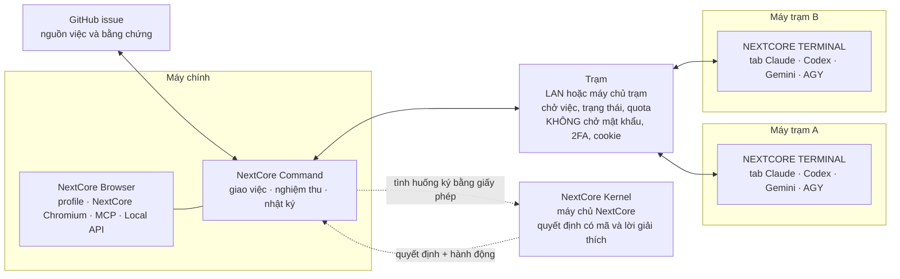

<div align="center">


# NextCore Browser

**Nền tảng làm việc cho người và AI agent: trình duyệt nhiều profile tách biệt, đội agent điều phối trên nhiều máy, và vẽ giao diện trước khi viết mã.**

[](https://github.com/kennetvn/nextcore-browser-releases/releases/latest)
[](https://github.com/kennetvn/nextcore-browser-releases/releases)


[**Tải về**](#tải-về) · [Sáu trụ cột](#sáu-trụ-cột) · [Kiến trúc](#kiến-trúc) · [Ứng dụng thực tế](#ứng-dụng-thực-tế) · [So sánh](#so-sánh) · [Hỏi đáp](#hỏi-đáp) · [Tài liệu](https://docs.homestaynextcore.org/nextcore-browser/) · [English](README.en.md)

</div>

---

> **Repo này chỉ chứa bản cài đặt, ghi chú phát hành và tài liệu giới thiệu.** NextCore Browser là phần mềm thương mại, mã nguồn đóng. Bản cài tại đây trùng từng byte với bản trên [homestaynextcore.org](https://homestaynextcore.org/nextcore-browser); đối chiếu bằng tệp `SHA512SUMS` kèm mỗi bản phát hành.

## NextCore Browser là gì

Một app cho Windows, macOS và Linux gồm ba lớp làm việc cùng nhau:

1. **Lớp trình duyệt.** Mỗi tài khoản chạy trong một profile riêng: NextCore Chromium riêng, vân tay ổn định riêng, proxy hoặc VPN riêng. Hàng chục hay hàng trăm tài khoản chạy trên một máy mà không dính nhau.
2. **Lớp điều phối agent.** Claude Code, Codex, Gemini, Antigravity chạy trong tab của app, trên nhiều máy, nhìn trên một màn hình. NextCore Command giao việc và nghiệm thu, cơ chế cân bằng quota giữ cho agent không đứng im, NextCore Kernel là bộ não ra quyết định.
3. **Lớp công cụ cho developer.** MCP và Local API để agent hay script điều khiển mọi thứ trong app; NextCore E2E để đo trang web trên profile đã đăng nhập; NEXTCORE DESIGN để vẽ giao diện trước khi viết mã.

<div align="center">

<br><sub>Quản lý profile. Ảnh chụp từ app thật, dữ liệu mẫu.</sub>
</div>

## Sáu trụ cột

<table>
<tr>
<td width="33%" valign="top">

### 1. Trình duyệt tách biệt
**NextCore Chromium**, vân tay ổn định mỗi profile, proxy và VPN riêng, mã 2FA ngay trên hàng, sao lưu mã hoá.

[Đọc tiếp →](docs/trinh-duyet-van-tay.md)

</td>
<td width="33%" valign="top">

### 2. Tự động hoá và dữ liệu
Kịch bản chạy trên nhiều profile, kho nhóm cục bộ, đọc bài khách thật, CRM, tạo ảnh và video.

[Đọc tiếp →](#2-tự-động-hoá-và-dữ-liệu)

</td>
<td width="33%" valign="top">

### 3. NEXTCORE TERMINAL
Mọi tab agent trên mọi máy trong một màn hình; giao issue GitHub bằng một phím; cân bằng quota giữa các tài khoản Claude.

[Đọc tiếp →](docs/terminal-command-quota.md)

</td>
</tr>
<tr>
<td width="33%" valign="top">

### 4. NextCore Command
Một chỉ huy cho cả đội: đọc Bàn giao, nghiệm thu bằng bằng chứng, chia việc, ghi nhật ký, tự dựng lại khi hỏng.

[Đọc tiếp →](docs/terminal-command-quota.md#nextcore-command-một-chỉ-huy-cho-cả-đội)

</td>
<td width="33%" valign="top">

### 5. NextCore Kernel và E2E
Bộ não ra quyết định có mã và lời giải thích; kiểm thử giao diện trên profile thật, không tự báo xanh khi chưa test gì.

[Đọc tiếp →](docs/kernel-e2e.md)

</td>
<td width="33%" valign="top">

### 6. NEXTCORE DESIGN
Nhiều agent vẽ song song, mỗi màn 20 ô (5 trạng thái × 4 khổ máy), nhập từ Penpot, Figma, Sketch, rồi mới viết mã.

[Đọc tiếp →](docs/design.md)

</td>
</tr>
</table>

## Vấn đề

| Việc bạn đang làm | Vướng ở đâu |
|---|---|
| Quản lý nhiều tài khoản trên cùng một trang | Một Chrome dùng chung thì cookie lẫn nhau; hồ sơ Chrome tách được dữ liệu nhưng vẫn chung phần cứng và chung một proxy |
| Mỗi tài khoản cần đường mạng riêng | Proxy đặt cho cả trình duyệt, không biết proxy nào đang hỏng, không đếm được lưu lượng |
| Tự động hoá việc lặp lại | Công cụ mở trình duyệt trắng mỗi lần chạy, mất đăng nhập, mã 2FA nằm ở điện thoại |
| Giao việc cho AI agent | Agent chỉ điều khiển được một trình duyệt trắng, không làm việc được trên nhiều tài khoản đã đăng nhập |
| Chạy agent trên nhiều máy | Mỗi máy một cửa sổ terminal, không biết máy nào đang làm gì, agent kẹt chờ bạn mà không ai thấy |
| Dùng nhiều tài khoản Claude | Một tài khoản cạn quota thì agent đứng im dù tài khoản khác còn dư; khung 5 giờ vừa làm mới mà mới dùng 20% thì 80% quota đã trả tiền mất trắng |
| Tin lời agent báo «xong» | Phải tự kiểm lại từng việc, vì agent hay báo xong và xanh quá sớm |
| Làm giao diện cùng agent | Agent viết mã ngay, làm xong mới thấy lệch ý; thiếu trạng thái lỗi, trống, đang tải; vỡ ở khổ máy nhỏ |

## Kiến trúc



- **Dữ liệu ở lại máy bạn.** Profile, cookie và khoá 2FA nằm trên máy. Trạm chỉ chở việc, trạng thái và quota.
- **Mỗi tài khoản NextCore có đúng một NextCore Command**, đặt ở máy chính. Máy trạm nhận việc từ máy chính.
- **Kernel chạy trên máy chủ NextCore,** gắn giấy phép và khoá thiết bị; bộ cài không mang luật.

## 1. Trình duyệt tách biệt

Mỗi tài khoản một profile, và mỗi profile tách ba lớp cùng lúc:

| Lớp | Tách bằng gì |
|---|---|
| **Dữ liệu** | Thư mục dữ liệu Chromium riêng: cookie, đăng nhập, Local Storage, IndexedDB, tiện ích |
| **Mạng** | Proxy riêng (HTTP, HTTPS, SOCKS4, SOCKS5) hoặc node VPN riêng, có kiểm sống chết và đo độ trễ |
| **Danh tính trình duyệt** | Một bộ vân tay riêng, ổn định giữa các lần mở |

- **NextCore Chromium:** bản Chromium chính thức dành cho tự động hoá, do app tự tải và quản lý, gắn nhận diện NextCore, sẵn cổng CDP.
- **Vân tay ổn định:** mỗi profile một hạt giống; màn hình, card đồ hoạ, số nhân CPU, RAM, Canvas, WebGL, âm thanh, phông chữ suy ra từ đó nên lần mở nào cũng giống lần trước. Múi giờ, ngôn ngữ, vị trí khớp IP proxy. User-Agent và Client Hints khớp đúng bản Chromium đang chạy. Đặt xong trước khi trang chạy dòng script đầu tiên, kể cả tab mới, popup và iframe.
- **Kho VPN:** node không ra mạng thì profile không mở, nên IP thật không lộ.
- **Kho proxy:** một proxy dùng chung nhiều profile, đếm GB và tiền theo kỳ, định tuyến theo tên miền để tiết kiệm lưu lượng.
- **Mã 2FA trên hàng profile**, sao lưu `.ncbak` mã hoá AES-256, che thông tin đăng nhập, xếp cửa sổ nhiều màn hình, thao tác hàng loạt.

<div align="center">

</div>

Chi tiết, ví dụ và giới hạn: [**NextCore Chromium, vân tay và cách ly profile**](docs/trinh-duyet-van-tay.md).

## 2. Tự động hoá và dữ liệu

| Mô-đun | Làm gì |
|---|---|
| **NEXTCORE AUTOMATIONS** | Kịch bản chạy trên nhiều profile. Ghép các bước thành luồng, chạy theo giờ hoặc bấm tay, xem từng bước đang ở đâu, dừng lại chờ bạn ở chỗ cần quyết định. Ghi thao tác trên một profile thành luồng rồi chạy lại trên profile khác. |
| **NEXTCORE GROUPCRAWL** | Kho nhóm cục bộ có số liệu: thành viên, nhịp bài đăng, vai trò của từng profile trong nhóm. Lọc theo vùng, quy mô, nhịp đăng. |
| **NEXTCORE CUSTOMERPOST** | Đọc bài khách đang tìm phòng từ các nhóm Facebook, tự crawl bằng profile của bạn, lọc theo thời gian, khu vực, danh mục và bình luận chào phòng. |
| **NEXTCORE CRM, SHEET, PMS** | Mở hộp thư CRM, bảng lịch phòng và màn vận hành ngay trong app, tự đăng nhập đúng tài khoản NextCore, phiên web tách khỏi mọi profile. |
| **NEXTCORE AGENT** | Nối khoá API của bạn với Anthropic, OpenAI, Gemini và hơn chục nhà cung cấp khác, xếp thứ tự ưu tiên thành chuỗi dự phòng, xem model, giá, hạn mức và lượt gọi gần đây. |
| **NEXTCORE MEDIA** | Tạo ảnh, video và phim ngắn bằng lượt miễn phí của các profile đã đăng nhập các dịch vụ AI, có Đạo diễn AI soạn cảnh và kích thước theo từng nền tảng. |
| **NEXTCORE TOOLS** | Tải video hàng loạt, quét kênh, bắt link luồng, tách lời thoại, lấy sản phẩm TMĐT, chuyển đổi, xoá metadata. Mọi việc chạy trên máy này. |
| **NEXTCORE EXTENSIONS, GROUPINVEST** | Bộ tiện ích trình duyệt và công cụ nhóm đi kèm trong app. |

> Bạn chịu trách nhiệm tuân thủ điều khoản của các trang web mình sử dụng. Tự động hoá trên các nền tảng có thể vi phạm điều khoản của nền tảng đó; NextCore Browser là công cụ quản lý và không thay đổi quy định của nền tảng nào.

## 3. NEXTCORE TERMINAL và cân bằng quota

NCB **không cài agent nào**: nó dùng Claude Code, Codex, Gemini, Antigravity bạn đã cài và các gói bạn đã mua, rồi lo phần điều phối quanh chúng.

<div align="center">

<br><sub>Cây máy, worktree, tab bên trái; terminal của tab đang chọn bên phải. Dữ liệu mẫu.</sub>
</div>

- **Một màn hình cho mọi tab trên mọi máy.** Vòng xoay là agent đang làm, dấu tích là xong, cảnh báo là đang chờ bạn duyệt, mặt trăng là máy đang ngủ. Gõ vào tab của máy khác như gõ trên máy mình, chữ hiện ngay.
- **Giao issue GitHub bằng một phím** (`Alt+I`). Tab nhận «Làm issue #N: tiêu đề — link» và bắt đầu làm.
- **Mỗi tab nói rõ nó chạy gì:** động cơ, model, mức suy luận, tài khoản, quota còn lại của khung 5 giờ và 7 ngày.
- **Quota là một bể chung.** Từ 85% xả dần, từ 95% đổi tài khoản ngay mà Claude vẫn tiếp tục đúng phiên cũ, dùng trước tài khoản sắp tới giờ làm mới. Mọi tài khoản cạn thì Command tự dừng, tự chạy lại sau giờ reset.
- **Dự phòng:** Antigravity khi gói Claude cạn; khoá Anthropic API của chính bạn cho tab thợ, **mặc định tắt**, trần 3 USD mỗi việc và 15 USD mỗi ngày.
- **Mỗi máy tự đo sức mình** (RAM, CPU, độ trễ) để quyết định nhận thêm tab hay không, giữ máy thức, đánh thức máy ngủ qua LAN.

<div align="center">

<br><sub>Tài khoản và quota của một máy, kèm dự báo chạm ngưỡng và công tắc tự đổi.</sub>
</div>

> Đây là cân bằng giữa các tài khoản và gói **của chính bạn**. NCB không thêm quota, không dùng tài khoản của người khác, và không thay đổi giới hạn của nhà cung cấp.

Chi tiết: [**NEXTCORE TERMINAL, NextCore Command và cân bằng quota**](docs/terminal-command-quota.md).

## 4. NextCore Command

Mỗi tài khoản NextCore có đúng **một** NextCore Command, đặt ở máy chính. Nó là chỉ huy của đội agent:

| Nó làm | Nó không làm |
|---|---|
| Đọc **Bàn giao** của tab thợ khi việc xong hoặc kẹt | Tự viết code thay tab thợ |
| Nghiệm thu: đạt, giao lại, hoặc ghi câu hỏi cho bạn | Nhập mã OTP, trả tiền, đổi giá bán, quyết định kinh doanh thay bạn |
| Chia việc lớn thành việc nhỏ, giao đúng máy đúng tab | Chạy khi bạn đã tắt hoặc tạm dừng |
| Ghi mỗi quyết định thành một dòng nhật ký để bạn đọc lại | Gõ vào tab bạn đang dùng |

Không có sự kiện thì Command ngồi yên và **không tốn token**. Tab Command hỏng thì tự dựng lại, việc đang theo dõi và nhật ký nằm trong NCB nên không mất gì.

<div align="center">

</div>

## 5. NextCore Kernel và NextCore E2E

**NextCore Kernel** là phần tri thức vận hành chạy bên trong NCB, là bộ não của NextCore Command và NextCore E2E. Nó không nằm trong bộ cài và không ghi vào repo của bạn.

- **Mỗi quyết định có mã ổn định và lời giải thích:** ví dụ `accepted` (nghiệm thu đạt), `kept-session` (giữ phiên còn sống), `parked-for-release` (chờ bản phát hành), kèm câu nói rõ đã xét gì và kết luận gì.
- **Học từ kết quả thật:** sau 24 giờ và 7 ngày, app ghi việc đó đạt, bị giao lại, mở lại hay báo xong giả; chỉ gửi mã, nhóm hành động và số đo, không gửi chữ tự do.
- **Thiết kế để vận hành thật:** gắn giấy phép và khoá thiết bị, chịu mất mạng tới 24 giờ, có trần lượt gọi, ngưỡng chỉnh từ xa mỗi 5 phút.

**NextCore E2E** đo trang web của bạn **trên profile thật, đã đăng nhập sẵn**, không cần dựng tài khoản thử: nhiều khổ màn × sáng/tối × màn chạm × mạng chậm; tràn ngang, chữ bị cắt, vùng bấm nhỏ, tương phản, lỗi console, header bảo mật; Lighthouse; SEO và mức sẵn sàng cho máy tìm kiếm AI; so ai thấy gì giữa các vai; chạy kịch bản nhiều bước và ghi hình. **Không tự báo xanh khi chưa test gì:** kịch bản rỗng, ảnh trùng nhau, selector không khớp, hay bản đang chạy chưa chứa commit cần thử đều bị từ chối.

Chi tiết: [**NextCore Kernel và NextCore E2E**](docs/kernel-e2e.md).

## 6. NEXTCORE DESIGN

Kho bản vẽ giao diện nằm ngay trong NCB. Nhiều agent vẽ song song qua MCP `ncd_*`, bạn xem và góp ý trên bản vẽ, rồi mới viết mã bám đúng bản vẽ.

<div align="center">

<br><sub>Trang vừa nhập từ một tệp Penpot, hai bảng khổ 1440 và 390 đứng đúng vị trí.</sub>
</div>

- **Mỗi màn 20 ô:** 5 trạng thái (trống, đang tải, hover và focus, lỗi, thành công) × 4 khổ (390, 768, 1280, 1920). `ncd_check` báo ô còn thiếu và màu nằm ngoài token.
- **Nhiều agent, không ai ghi đè ai:** bảng đang có agent sửa thì khoá, hiện tên agent và thời gian nhả.
- **Nhập từ Penpot, Figma, Sketch, Adobe XD, PDF, HTML, SVG, artifact claude.ai.** Nhập Penpot khớp vị trí và kích thước trong ±1 px (đo 3.300 bảng thật: 0 bảng lệch), trình Migrate 6 bước có bước Soát bằng độ giống SSIM từ 0,95, chỉ đọc với nguồn.
- **Xuất PNG, SVG và gửi link xem** cho người không cài app.
- Kho của đội NextCore (03/11/2026): **297 bản vẽ, 3.231 bảng**.

Chi tiết: [**NEXTCORE DESIGN**](docs/design.md).

## Cho developer

```bash
# Mở profile, nhận wsEndpoint cho Playwright
curl -X POST -H "Authorization: Bearer $NCB_TOKEN" \
  http://127.0.0.1:19880/api/v1/profiles/p_7f3a/start
```

- **Local API và CDP:** Playwright, Puppeteer nối thẳng vào profile. Chỉ nghe `127.0.0.1`, token riêng mỗi máy.
- **MCP có sẵn trong app:** gần 190 công cụ, bộ nhỏ cho client giới hạn số công cụ (`?bo=app` 127 công cụ, `?bo=co-ban` khoảng 50). Kết nối một chạm cho Claude Code, Cursor, VS Code, Antigravity.
- **`browser_*` cùng tên với Playwright MCP chính thức,** nên agent đã biết là dùng được ngay. Một phiên MCP một profile, nên hai agent không dẫm lên nhau.

Chi tiết: [**Local API, CDP và MCP**](docs/developer.md).

## Ứng dụng thực tế

| Ai dùng | Làm gì với NextCore Browser |
|---|---|
| **Người bán hàng nhiều cửa hàng, nhiều kênh** | Mỗi cửa hàng một profile đăng nhập sẵn, không lẫn cookie giữa các cửa hàng. |
| **Đội chăm sóc khách hàng** | Mỗi nhân viên và mỗi kênh một profile. Xếp nhiều cửa sổ thành lưới trên màn hình phụ để theo dõi cùng lúc. |
| **Agency và đội vận hành nội dung** | Quản lý trang và nhóm cộng đồng của nhiều khách hàng, tách tài khoản theo từng khách. Kịch bản đăng bài chạy theo giờ, giãn nhịp, báo kết quả từng nhóm. |
| **Nghiên cứu thị trường, đọc dữ liệu nhóm** | Kho nhóm cục bộ ghi số thành viên và nhịp bài đăng; lọc theo vùng, quy mô, nhịp đăng để chọn nơi đáng làm việc. |
| **QA và kiểm thử web** | Mỗi vai trò người dùng một profile; Playwright hoặc Puppeteer nối qua CDP; NextCore E2E đo nhiều khổ máy, sáng tối, mạng chậm. |
| **Developer dùng AI agent** | Để Claude Code, Cursor hay Antigravity tạo, mở và điều khiển nhiều profile đã đăng nhập thay vì một trình duyệt trắng mỗi lần chạy. |
| **Đội phát triển với nhiều agent** | NEXTCORE TERMINAL chạy nhiều agent trên nhiều máy; Command giao issue GitHub, nghiệm thu Bàn giao; cân bằng quota giữa các tài khoản Claude để agent không đứng im giữa chừng. |
| **Đội thiết kế giao diện** | NEXTCORE DESIGN cho nhiều agent vẽ song song đủ trạng thái và khổ máy, nhập bản vẽ cũ, gửi link xem. |

## So sánh

| | Chỉ Playwright MCP | Một Chrome nhiều hồ sơ | NextCore Browser |
|---|---|---|---|
| Giữ đăng nhập giữa các lần chạy | Không, mỗi lần một trình duyệt mới | Có | Có |
| Proxy riêng từng tài khoản | Không | Không, một proxy cho cả trình duyệt | Có, từng profile, có kiểm proxy |
| Vân tay riêng, ổn định từng tài khoản | Không | Không, chung phần cứng | Có, hạt giống riêng mỗi profile |
| Agent tạo và quản lý profile | Không | Không | Có, qua MCP |
| Nhiều agent trên các tài khoản khác nhau cùng lúc | Một trình duyệt mỗi server | Dễ lẫn cookie giữa tài khoản | Có, một phiên một profile |
| Điều phối đội agent trên nhiều máy | Không | Không | Có, NEXTCORE TERMINAL và NextCore Command |
| Cân bằng quota giữa các tài khoản Claude | Không | Không | Có, bể quota chung |
| Kiểm thử trên profile đã đăng nhập | Phải dựng tài khoản thử | Làm tay | Có, NextCore E2E |
| Chỉ chạy trên máy bạn | Có | Có | Có, MCP chỉ nghe 127.0.0.1 |

## Bảo mật và quyền riêng tư

- **Dữ liệu ở lại máy bạn.** Sao lưu `.ncbak` mã hoá AES-256.
- **Local API và MCP chỉ nghe `127.0.0.1`,** mỗi máy một token, mỗi trợ lý một token thu hồi riêng được.
- **Trạm nhiều máy không chở mật khẩu, 2FA, OTP hay cookie.**
- **Che thông tin đăng nhập:** agent chỉ đọc nguyên văn một ô qua lệnh riêng, từng ô một, mỗi lần gọi đều được ghi lại. Không công cụ nào trả mật khẩu proxy.
- **Khoá Anthropic API không đi vào lệnh, tệp hay nhật ký;** chỉ vào biến môi trường của tab đó. Agent qua MCP không bật được chế độ chạy bằng khoá API.
- **Bản cài không mang luật của Kernel;** máy bị thu hồi thì khoá bị xoá.
- App cần kết nối tới `homestaynextcore.org` ít nhất 3 ngày một lần để giữ phiên đăng nhập.
- Danh sách cập nhật (`latest*.yml`) có chữ ký số ed25519. Đối chiếu bản tải về bằng `SHA512SUMS`.
- Báo lỗ hổng bảo mật theo [SECURITY.md](SECURITY.md).

## Tải về

**Bản mới nhất: 0.3.191** (12/11/2026). Lấy bản cài và tệp `SHA512SUMS` ở [trang Releases](https://github.com/kennetvn/nextcore-browser-releases/releases/latest).

| Nền tảng | Tệp | Dung lượng |
|---|---|---|
| **Windows** 10 và 11, 64-bit | Bộ cài `Setup.exe` | khoảng 145 MB |
| **Windows** Portable | `Portable.exe`, không cần cài | khoảng 145 MB |
| **macOS** Apple Silicon (M1 đến M4) | `mac-arm64.dmg` | khoảng 163 MB |
| **macOS** Intel | `mac-x64.dmg` | khoảng 171 MB |
| **Linux** (Ubuntu, Debian), bản 0.3.190 | `AppImage` và `.deb` | khoảng 134 đến 179 MB |

Máy farm Windows có thể tải và cài bằng một dòng PowerShell, không hiện màn cảnh báo:

```powershell
curl.exe -L -o "$env:TEMP\ncb-setup.exe" https://homestaynextcore.org/downloads/nextcore-browser/moi-nhat/windows; & "$env:TEMP\ncb-setup.exe"
```

**Cài đặt trong ba bước, khoảng hai phút:**

1. **Tải bộ cài** từ bảng trên.
2. **Cài đặt.** Tải bằng trình duyệt thì Windows có thể hiện màn xanh «Windows bảo vệ máy tính của bạn»: bấm *Thông tin bổ sung*, rồi *Chạy dù thế nào đi nữa*.
3. **Đăng nhập NextCore.** App hiện mã 8 ký tự, bấm *Cho phép* trên [homestaynextcore.org](https://homestaynextcore.org). Trong giai đoạn beta không giới hạn số máy.

| Yêu cầu | |
|---|---|
| Windows | 10 hoặc 11, 64-bit |
| macOS | Apple Silicon và Intel |
| Linux | AppImage, Ubuntu hoặc Debian |
| Bộ nhớ | Tuỳ số profile mở cùng lúc; chân app báo RAM vàng khi quá 70%, đỏ khi quá 90% |
| Tài khoản | Tài khoản NextCore đang hoạt động; dùng thử miễn phí trước khi chọn gói |

App tự tải bản mới và cập nhật khi bạn khởi động lại. Xem [CHANGELOG.md](CHANGELOG.md) hoặc trang [Releases](https://github.com/kennetvn/nextcore-browser-releases/releases).

## Hỏi đáp

<details>
<summary><b>NextCore Browser có cài sẵn agent AI không?</b></summary>

Không. NCB dùng Claude Code, Codex, Gemini, Antigravity bạn đã cài và các gói bạn đã mua. Phần NCB làm là điều phối: hiển thị, giao việc, nghiệm thu, cân bằng quota.
</details>

<details>
<summary><b>Dữ liệu profile nằm ở đâu? Có lên máy chủ không?</b></summary>

Profile, cookie và khoá 2FA nằm trên máy bạn. Trạm nhiều máy chỉ chở việc, trạng thái và quota, không chở mật khẩu, 2FA, OTP hay cookie. Máy chủ NextCore tính quyết định của Kernel và quản lý đăng nhập, giấy phép.
</details>

<details>
<summary><b>Mất mạng thì sao?</b></summary>

Quyết định của Kernel chạy tiếp bằng bản lưu trên máy tối đa 24 giờ. Quá hạn thì NextCore Command và NextCore E2E báo không khả dụng cho tới khi có mạng lại. App cần kết nối tới `homestaynextcore.org` ít nhất 3 ngày một lần để giữ phiên đăng nhập.
</details>

<details>
<summary><b>Cân bằng quota có vi phạm điều khoản của nhà cung cấp AI không?</b></summary>

NCB chỉ cân bằng giữa các tài khoản và gói của chính bạn: nó không thêm quota, không dùng tài khoản của người khác và không đổi giới hạn của nhà cung cấp. Bạn vẫn chịu trách nhiệm đọc và tuân thủ điều khoản của từng nhà cung cấp.
</details>

<details>
<summary><b>Agent có tự tiêu tiền của tôi không?</b></summary>

Không. Chế độ chạy bằng khoá Anthropic API **mặc định tắt**, chỉ bật ở cấu hình trong app (agent qua MCP không bật được), có trần 3 USD mỗi việc và 15 USD mỗi ngày. Command không trả tiền, không nhập mã OTP, không đổi giá bán hay quyết định kinh doanh thay bạn.
</details>

<details>
<summary><b>Tôi dùng được trình duyệt khác thay NextCore Chromium không?</b></summary>

Được, nhưng chỉ là lựa chọn phụ. Profile mở bằng Chrome, Edge, Brave, Cốc Cốc hay Firefox cài sẵn sẽ không chạy được kịch bản, tiện ích và tự động hoá của NextCore, và app cảnh báo ngay trên hàng profile.
</details>

<details>
<summary><b>Tự động hoá trên Facebook hay các nền tảng khác có an toàn không?</b></summary>

Tự động hoá trên các nền tảng có thể vi phạm điều khoản của nền tảng đó. NCB không thay đổi quy định của nền tảng nào. Nên để agent dừng lại xin bạn duyệt trước các hành động công khai như đăng bài, nhắn tin hàng loạt hay thanh toán.
</details>

<details>
<summary><b>Tôi có thể dùng NextCore Kernel riêng cho dự án khác không?</b></summary>

Bạn được dùng NextCore Command và NextCore E2E cho công việc của mình, trên repo của mình. Kernel chỉ được áp dụng, không được bóc tách hay chưng cất: không đọc, chép hay suy ngược ra quy tắc, lời nhắc, cách chấm điểm. Xem [LICENSE.md](LICENSE.md).
</details>

<details>
<summary><b>Giá và gói dịch vụ?</b></summary>

Có dùng thử miễn phí trước khi chọn gói; giai đoạn beta không giới hạn số máy. Chi tiết gói xem ở [homestaynextcore.org](https://homestaynextcore.org/nextcore-browser).
</details>

## Lộ trình

**Đang có (24 mô-đun, bản 0.3.191)**
Trình duyệt: Profile và proxy, Vân tay trình duyệt, Thao tác hàng loạt, Xếp cửa sổ, KHO PROXY, Mã 2FA, Sao lưu, KHO VPN · Dữ liệu và khách: GROUPCRAWL, CUSTOMERPOST, CRM · Tự động hoá: AUTOMATIONS, AGENT, MEDIA, NCB COMMAND · Cho developer: Local API + CDP, MCP, NEXTCORE TERMINAL, NCB_E2E, NEXTCORE DESIGN · Thêm trong app: EXTENSIONS, TOOLS, GROUPINVEST.

**Sắp tới**
- Đồng bộ profile qua nhiều máy
- Lịch chạy kịch bản theo giờ, theo ngày, theo ca làm
- Nhóm làm việc nhiều người: phân quyền theo nhóm profile, nhật ký ai mở profile nào

## Tài liệu

| | |
|---|---|
| [NextCore Chromium, vân tay](docs/trinh-duyet-van-tay.md) | Cách ly profile, vân tay, proxy, VPN |
| [NEXTCORE TERMINAL, Command, quota](docs/terminal-command-quota.md) | Điều phối agent, cân bằng quota, nhiều máy |
| [NextCore Kernel và E2E](docs/kernel-e2e.md) | Bộ não ra quyết định và kiểm thử trên profile thật |
| [NEXTCORE DESIGN](docs/design.md) | Vẽ trước, viết mã sau |
| [Local API, CDP, MCP](docs/developer.md) | Điều khiển bằng script và AI agent |
| [Hướng dẫn đầy đủ](https://docs.homestaynextcore.org/nextcore-browser/) | Từng mô-đun, khắc phục lỗi |

## Hỗ trợ

- **Lỗi và góp ý về app:** [mở issue](https://github.com/kennetvn/nextcore-browser-releases/issues/new/choose) kèm phiên bản app và hệ điều hành. Đừng dán mật khẩu, token hay khoá 2FA.
- **Hỗ trợ tài khoản và gói dịch vụ:** liên hệ qua [homestaynextcore.org](https://homestaynextcore.org).
- **Lỗ hổng bảo mật:** xem [SECURITY.md](SECURITY.md), không đăng công khai.

## Giấy phép

NextCore Browser là phần mềm thương mại, **mã nguồn đóng**. Bản cài trong repo này chỉ được dùng theo [Điều khoản sử dụng](https://homestaynextcore.org/terms) của NextCore. Không dịch ngược, không bóc tách, không dùng kết quả của app để dựng sản phẩm cạnh tranh. Chi tiết ở [LICENSE.md](LICENSE.md).

---

<div align="center">
<sub>© 2026 NextCore · <a href="https://homestaynextcore.org/nextcore-browser">homestaynextcore.org/nextcore-browser</a></sub>
</div>
