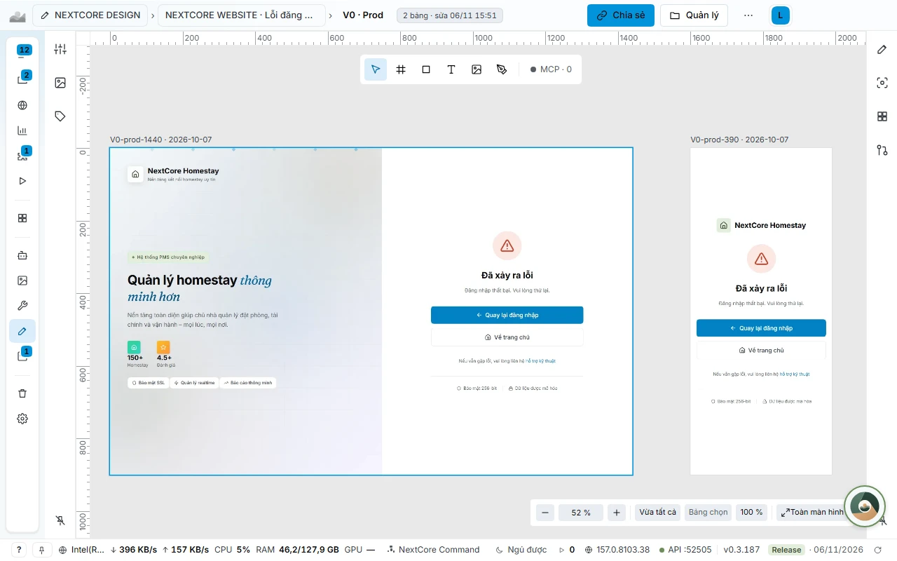
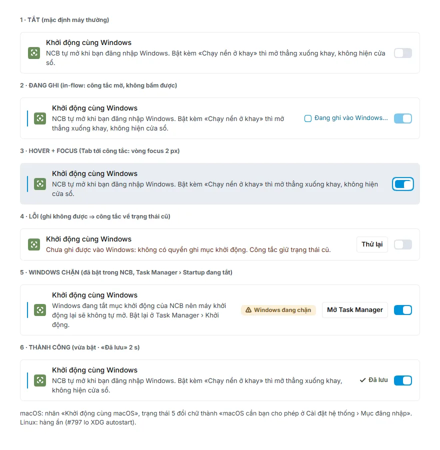

# NEXTCORE DESIGN: vẽ màn trước, viết mã sau

[← Về trang chính](../README.md) · [English](en/design.md)

**NEXTCORE DESIGN** (NCD) là kho bản vẽ giao diện nằm ngay trong NextCore Browser. Nhiều agent vẽ song song qua MCP `ncd_*`, bạn xem và góp ý trên bản vẽ, rồi mới viết mã bám đúng bản vẽ.

## Bài toán

| Khi làm giao diện cùng AI agent | Hậu quả |
|---|---|
| Agent viết mã giao diện ngay, không có bản vẽ | Làm xong mới thấy lệch ý, vá dần, nhìn như template |
| Chỉ vẽ trạng thái đẹp nhất | Thiếu trạng thái trống, đang tải, lỗi, hover; vỡ ở khổ máy nhỏ |
| Nhiều agent sửa cùng một bản vẽ | Ghi đè lên nhau |
| Bản vẽ nằm ở Penpot, Figma, Sketch, PDF | Không một chỗ nào agent đọc và so được |

## Mỗi màn có sẵn 20 ô

Mỗi màn đủ **5 trạng thái × 4 khổ máy**:

| | 390 | 768 | 1280 | 1920 |
|---|---|---|---|---|
| Trống | ✓ | ✓ | ✓ | ✓ |
| Đang tải | ✓ | ✓ | ✓ | ✓ |
| Rê chuột, focus | ✓ | ✓ | ✓ | ✓ |
| Lỗi | ✓ | ✓ | ✓ | ✓ |
| Thành công | ✓ | ✓ | ✓ | ✓ |

- Tab **Độ phủ 5×4** đếm ô còn thiếu và hiện chip cho từng ô.
- `ncd_check` báo ô còn thiếu, màu nằm ngoài token và tên màn, thư mục, dự án sai quy ước, kèm đề xuất tên đúng.
- Từ bảng phải bấm **Giao agent vẽ phần thiếu**: NCD tạo việc cho agent đang rảnh qua NEXTCORE TERMINAL.

## Nhiều agent vẽ cùng một dự án

- **Khoá bảng.** Bảng đang có agent sửa thì viền vàng kèm biểu tượng khoá và tên viết tắt của agent. Chấm **MCP · N** cho biết bao nhiêu agent đang giữ bảng trong trang này, bấm để xem ai, máy nào và còn bao lâu thì nhả. Không ai ghi đè ai.
- **Tạo bằng agent.** Trong một thư mục bấm **Tạo bằng agent**, ghi mô tả màn, chọn trạng thái và khổ cần vẽ, bấm **Giao agent**. Agent gửi từng ô về; ngăn hiện ô nào đã có, ô nào còn thiếu.
- **Hoàn tác và làm lại từng bước**, ghi chú ngay trên bản vẽ.

## Nhập và chuyển bản vẽ cũ

Kéo thả hoặc dán vào NCD: HTML, SVG, PNG, `.zip`, tệp Penpot `.penpot` hoặc link chia sẻ Penpot, Sketch, Adobe XD, PDF (mỗi trang thành một ảnh tham chiếu), link Figma và artifact claude.ai. Mỗi tệp có một dòng tiến độ riêng, tệp lỗi không làm hỏng cả lô.

- **Giữ đúng như bản gốc.** Nhập từ Penpot giữ nguyên **trang**, vị trí và kích thước từng bảng, chữ và hình chú thích ngoài bảng, thứ tự lớp, auto-layout hàng và cột, viền nét đứt, nhiều lớp viền. Vị trí và kích thước khung khớp bản gốc trong ±1 px. Đo ngày 02/11/2026 trên 3.300 bảng của một team Penpot thật: 0 bảng lệch vị trí khung.
- **Phông có sẵn trong app** (Inter, Inter Tight, Fraunces, JetBrains Mono, Geist Mono, Be Vietnam Pro, Roboto Mono, Source Sans Pro) nên bản xem và bản xuất vẽ đúng phông kể cả khi không có mạng.
- **Trình Migrate 6 bước** chuyển cả một khu bản vẽ cũ: Nguồn, Kiểm kê, Đích, Giao agent, Soát, Chốt. Chạy lại không tạo bản trùng. Bước **Soát** đặt ảnh gốc cạnh ảnh NCD kèm độ giống SSIM, đạt từ 0,95.
- **Chỉ đọc với nguồn.** NCD không ghi gì lên Penpot hay claude.ai trong suốt quá trình.

## Canvas và công cụ

- **Canvas trang:** mở một màn là vào tab *Trang*, các bảng xếp thành lưới (hàng là trạng thái, cột là khổ máy). Bảng trái có Trang, Lớp, Tài sản, Token; bảng phải có Design, Inspect (rộng × cao, x/y, CSS sinh ra, token, độ tương phản của phần tử dưới điểm bấm) và Trạng thái & khổ.
- **Công cụ:** Chọn, Khung, Hình, Chữ, Ảnh, Pen, thu phóng 5% tới 400% (phóng to vẫn nét), phím tắt như Figma.
- **Xem HTML:** mở bảng dạng trang thật, rê chuột thấy hiệu ứng hover và nhãn kích thước, bấm để ghim và đọc style cùng token đang dùng.
- **Thư mục, chọn nhiều màn, gắn `#issue`, duyệt** (Chờ duyệt, Đã duyệt), thùng rác khôi phục được, gợi ý gom màn theo tiền tố tên.
- **Xuất PNG, SVG**, và **gửi link xem** cho người không cài app.

## Con số thật

Kho NEXTCORE DESIGN của đội NextCore (03/11/2026): **297 bản vẽ, 3.231 bảng, 20 ô mỗi màn**. Kho gần 3.000 màn chuyển sang cấu trúc mới trong khoảng 1 đến 2 giây.

## Quy trình design-first

1. Agent vẽ màn trong NCD, đủ 5 trạng thái × 4 khổ, dùng token thay vì màu viết tay.
2. `ncd_check` soát: ô thiếu, màu ngoài token, tên sai.
3. Xuất bản vẽ, gửi link xem, gắn `#issue`.
4. Chỉ khi đó mới viết mã, **bám 100% bản vẽ**.

## Tài liệu chi tiết

[NEXTCORE DESIGN](https://docs.homestaynextcore.org/nextcore-browser/nextcore-design/) · [Chuyển bản vẽ về NEXTCORE DESIGN](https://docs.homestaynextcore.org/nextcore-browser/chuyen-ban-ve-ve-ncd/)
