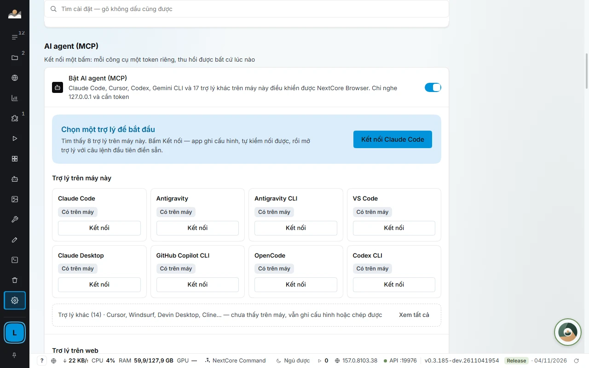

# Cho developer: Local API, CDP và MCP

[← Về trang chính](../README.md) · [English](en/developer.md)

Mọi thứ bấm được trong app đều điều khiển được bằng script hoặc bằng AI agent. Chỉ nghe trên máy bạn, có token.

## Local API và CDP

```bash
# Mở profile, nhận wsEndpoint cho Playwright
curl -X POST -H "Authorization: Bearer $NCB_TOKEN" \
  http://127.0.0.1:19880/api/v1/profiles/p_7f3a/start
```

```json
{ "pid": 18244, "debugPort": 52144,
  "wsEndpoint": "ws://127.0.0.1:52144/devtools/browser/9c1e…" }
```

- Tạo, mở, đóng profile và lấy cổng CDP để **Playwright** hoặc **Puppeteer** điều khiển như một trình duyệt thường.
- Chỉ nghe `127.0.0.1`, token riêng cho mỗi máy, từ chối yêu cầu đến từ trang web.



## MCP: để AI agent điều khiển nhiều profile đã đăng nhập

App có sẵn một **máy chủ MCP** chạy trên chính Local API. Trợ lý AI nối vào `http://127.0.0.1:<cổng>/mcp` kèm token. Không mở gì ra Internet.

- **Kết nối một chạm** cho Claude Code, Cursor, VS Code, Antigravity: app tự ghi tệp cấu hình kèm token riêng cho từng trợ lý, rồi tự kiểm bằng cách gọi danh sách công cụ y như trợ lý sẽ gọi. Client MCP khác dùng khối JSON trong app. Mỗi trợ lý một token, thu hồi riêng được.
- **`browser_*` cùng tên với Playwright MCP chính thức,** nên agent đã biết Playwright MCP là dùng được ngay. Agent thao tác trang **trong từng profile**, giữ nguyên đăng nhập, proxy và tiện ích của profile đó.
- **Agent quản lý profile thay bạn:** liệt kê, tạo, sửa, mở, đóng, xếp cửa sổ thành lưới, sao lưu ra tệp mã hoá, kiểm proxy, đo rò rỉ IP, múi giờ, WebRTC.
- **Vận hành cả app:** GROUP CRAWL, CUSTOMERPOST, AUTOMATIONS, MEDIA, tài khoản, quota, terminal nhiều máy, NEXTCORE DESIGN (`ncd_*`).
- **Một phiên MCP một profile.** Muốn chạy song song nhiều profile thì mở nhiều phiên. Profile phiên này đang giữ thì phiên khác bị từ chối, nên hai agent không dẫm lên nhau.

### Bộ công cụ theo giới hạn của client

Đủ bộ có gần 190 công cụ, nặng với trợ lý giới hạn số công cụ. Thêm `?bo=` vào địa chỉ để chọn bộ nhỏ hơn:

| Địa chỉ | Có gì | Dùng cho |
|---|---|---|
| `/mcp` | Mọi công cụ | Claude Code, Claude Desktop, Antigravity, Gemini CLI, Codex CLI, OpenCode |
| `/mcp?bo=app` | Quản lý profile, phiên, `browser_*`, vận hành app (127 công cụ) | VS Code (giới hạn 128), Cline, Roo Code, Kiro, Continue, Copilot CLI, Zed |
| `/mcp?bo=co-ban` | Quản lý profile, phiên, 20 công cụ `browser_*` hay dùng (khoảng 50 công cụ) | Cursor, Windsurf, LM Studio |

### Bạn nói gì với agent

- «Liệt kê các profile nhóm Shop đang lỗi proxy.»
- «Tạo 10 profile tên Shop 01 tới Shop 10, gắn lần lượt các proxy này.»
- «Mở 4 profile nhóm Farm 2 và xếp thành lưới 2×2 trên màn hình phụ.»
- «Đo trang này ở bốn khổ máy, sáng và tối, rồi cho biết chỗ nào chữ bị cắt.»

## So với cách khác

| | Chỉ Playwright MCP | Một Chrome nhiều profile | NextCore Browser |
|---|---|---|---|
| Giữ đăng nhập giữa các lần chạy | Không, mỗi lần một trình duyệt mới | Có | Có |
| Proxy riêng từng tài khoản | Không | Không, một proxy cho cả trình duyệt | Có, từng profile, có kiểm proxy |
| Agent tạo và quản lý profile | Không | Không | Có, qua MCP |
| Nhiều agent trên các tài khoản khác nhau cùng lúc | Một trình duyệt mỗi server | Dễ lẫn cookie giữa tài khoản | Có, một phiên một profile |
| Chỉ chạy trên máy bạn | Có | Có | Có, MCP chỉ nghe 127.0.0.1 |

## An toàn

- Chỉ máy này gọi được (`127.0.0.1`), bắt token, từ chối yêu cầu từ trang web. Giữ token như mật khẩu; lộ thì đổi token hoặc thu hồi trợ lý đó.
- Không công cụ nào trả mật khẩu proxy. Khi **Che thông tin đăng nhập** bật, danh sách profile che mật khẩu tài khoản, 2FA, mật khẩu email, cookie. Agent chỉ đọc nguyên văn một ô qua lệnh riêng, từng ô một, và mỗi lần gọi đều ghi trong *Lần gọi gần nhất*.
- Các lệnh đụng tới thư mục dữ liệu, thoát hay khởi động lại app chỉ chạy được trên chính máy đó.
- Tự động hoá trên các nền tảng có thể vi phạm điều khoản của nền tảng đó. Nên để agent dừng lại xin bạn duyệt trước các hành động công khai (đăng bài, nhắn tin hàng loạt, thanh toán).

## Tài liệu chi tiết

[Local API](https://docs.homestaynextcore.org/developer/local-api/) · [MCP cho AI agent](https://docs.homestaynextcore.org/developer/mcp/) · [NextCore E2E](kernel-e2e.md) · [NEXTCORE DESIGN](design.md)
