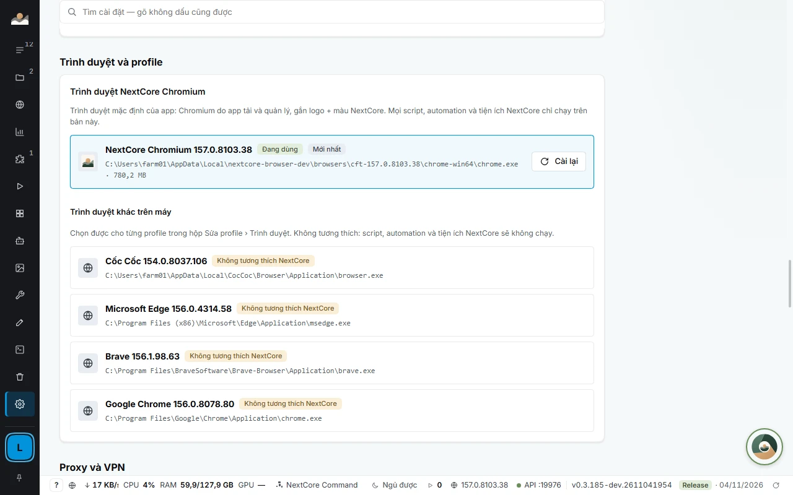
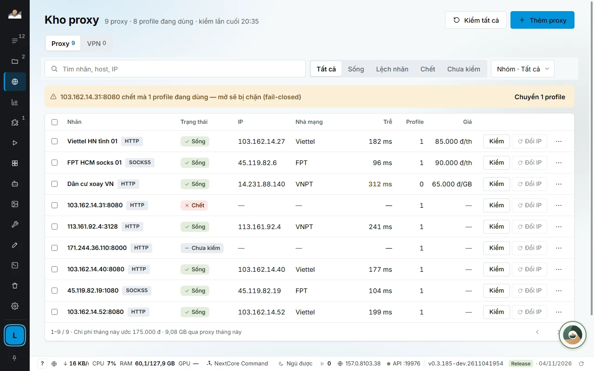
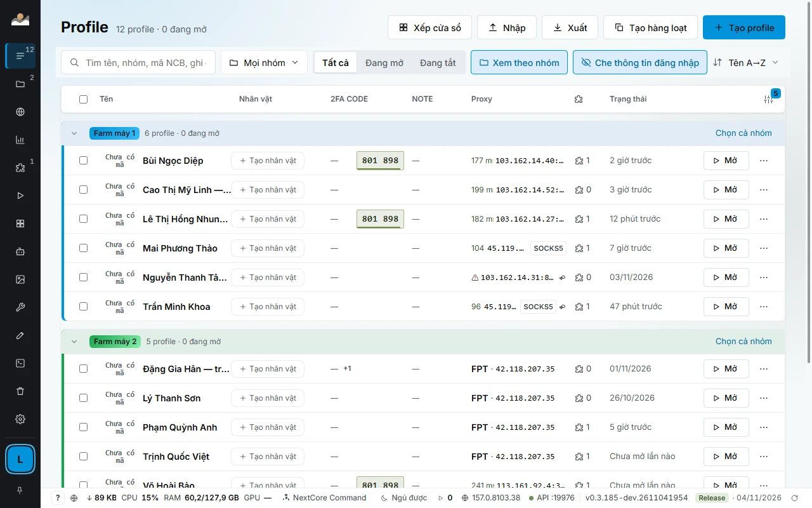

# NextCore Chromium, fingerprints and profile isolation

[← Back to main page](../../README.en.md) · [Tiếng Việt](../trinh-duyet-van-tay.md)

This is the foundation of NextCore Browser: each account runs in an isolated browser with a stable browser identity and its own network path.

## Why each profile needs isolation

With one Chrome shared by many accounts, cookies, page storage and extensions mix together, and every account goes through the same network path and carries the same browser trace. Chrome profiles separate data but still run on the same machine with the same hardware configuration and the same proxy.

NextCore Browser isolates three layers at once:

| Layer | Isolated by |
|---|---|
| **Data** | Each profile has its own Chromium data folder: cookies, logins, Local Storage, IndexedDB, extension data. One profile's cookies never leak into another. |
| **Network** | Each profile has its own proxy (or its own VPN node), with liveness checks and latency measurement. |
| **Browser identity** | Each profile has its own fingerprint, stable between launches. |

## NextCore Chromium

Every profile runs **NextCore Chromium** by default: the official Chromium build for automation (Chrome for Testing), downloaded and managed by the app, then branded as NextCore.

- **Managed by the app.** The first time you open a profile, the app downloads the latest stable build (about 170 MB, once). Update, reinstall and delete old builds right in *SETTINGS › Browser and profiles*. After an update, the previous build stays on the machine so you can roll back.
- **NextCore branding.** The NextCore logo on file icons, the window corner and the taskbar (macOS: Dock, Finder, menu bar), and the NextCore blue theme color for the tab bar and address bar. Colors you changed yourself are kept.
- **Ready to be controlled.** It can load NextCore extensions and has a CDP port for the Local API, automation scripts and window arrangement. All NextCore scripts, scenarios and extensions run only on this build.
- **Other browsers are only a secondary option.** The app lists the Chrome, Edge, Brave, Cốc Cốc and Firefox installed on the machine, each labeled *Not compatible with NextCore*. Profiles opened with them will not run NextCore scripts and extensions, and the edit dialog warns you right away.

## Browser fingerprint

Each profile receives its own **seed** when it is created. The configuration that web pages can read is derived from that seed, so every launch looks like the previous one:

| Property | How it is handled |
|---|---|
| Screen, graphics card, CPU cores, RAM | Derived from the seed, using only configurations that really exist on that operating system |
| Canvas, WebGL, audio, fonts | Derived from the seed, stable between launches |
| Time zone, language, location | Match the proxy's IP, taken from the most recent check |
| User-Agent and Client Hints | Match the exact Chromium build that is running |

The fingerprint is set **before the page runs its first line of script**, in new tabs, popup windows and iframes alike.

- **Two profiles on the same machine look like two different machines.** For example, one profile reports 1920×1080, 8 cores, RTX 3060; the other reports 1536×864, 12 cores, Intel UHD 770, and each keeps its seed across launches.
- **Preserved even when backed up to another machine.** The `.ncbak` file carries the fingerprint along with the logins.
- **Change the fingerprint when needed.** The *Change fingerprint* button issues a new seed. Cloning a profile carries over the browser data (cookies, Local Storage, IndexedDB, extension data), so it stays logged in like the original, while the fingerprint is generated anew.

## Proxy, VPN and routing

- **Proxy per profile:** HTTP, HTTPS, SOCKS4, SOCKS5, with or without a password. The proxy line shows the carrier, IP and latency from the most recent check. A failed proxy turns red right on the row, with the reason.
- **Shared proxy store:** one proxy assigned to many profiles, change it in one place and it changes for all. The *Proxy traffic* screen adds up GB and cost per period, shows which profile uses the most, and lets you set a budget.
- **Routing by domain:** rule sets that save GB, block ads, and per-site rules.
- **VPN store per profile:** each profile goes through its own node. **If a node has no connectivity, the profile does not open**, so the machine's real IP is never exposed.
- **Leak testing:** agents over MCP have tools to test a profile for IP, time zone and WebRTC leaks.

## Managing large numbers

- **Bulk operations:** select 5 or 50 profiles (Shift + click selects a range), then open, close, assign a proxy, set a group or delete in one pass. Create in bulk from a list, import and export profile lists.
- **Window arrangement:** choose the target monitor, and the app suggests the best-fitting grid for the number of open windows, including rotated portrait screens. Page zoom from 25% to 200% lets you view many accounts at once.
- **2FA codes on the profile row:** a 6-digit code that changes color when the 30-second window is about to end, click to copy. The key never leaves the machine.
- **`.ncbak` backup:** AES-256 encrypted, carries over to another machine and keeps logins. If a single byte of the file is corrupted, restore is refused.
- **Credential masking:** a toggle that masks account passwords, 2FA, email passwords and cookies in the list; an agent reads a single cell verbatim only through a dedicated command, one cell at a time, and every call is logged.

## Responsible use

NextCore Browser is a tool for managing many accounts and for automation. Automation on platforms (Facebook and other sites) may violate those platforms' terms. You are responsible for complying with the terms of the sites you use. With agents, have the agent stop and ask for your approval before public actions such as posting, mass messaging or payments.

## Detailed documentation

[Profiles and proxy](https://docs.homestaynextcore.org/nextcore-browser/profile/) · [Browser and versions](https://docs.homestaynextcore.org/nextcore-browser/trinh-duyet-phien-ban/) · [Proxy store](https://docs.homestaynextcore.org/nextcore-browser/proxy/) · [2FA codes](https://docs.homestaynextcore.org/nextcore-browser/ma-2fa/) · [Backup and restore](https://docs.homestaynextcore.org/nextcore-browser/sao-luu-khoi-phuc/)
