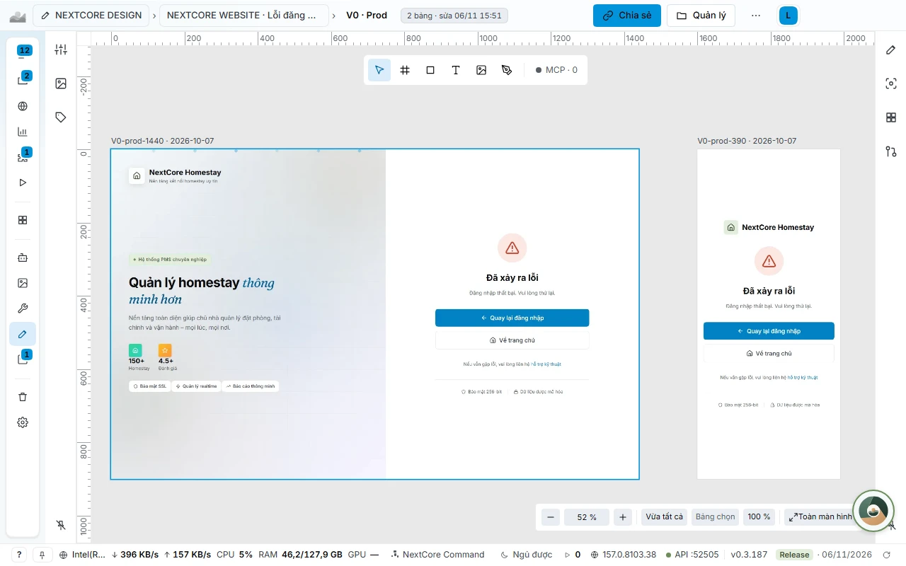
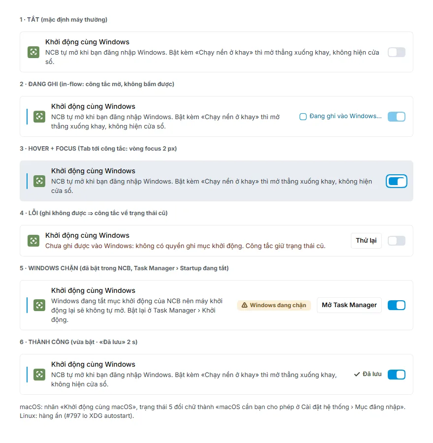

# NEXTCORE DESIGN: draw the screen first, write code later

[← Back to main page](../../README.en.md) · [Tiếng Việt](../design.md)

**NEXTCORE DESIGN** (NCD) is the interface drawing store right inside NextCore Browser. Many agents draw in parallel through the `ncd_*` MCP, you review and comment on the drawing, and only then is code written to match the drawing exactly.

## The problem

| When building interfaces with AI agents | Consequence |
|---|---|
| The agent writes interface code right away, with no drawing | Only afterwards you see it missed the intent, patches pile up, it looks like a template |
| Only the best-looking state is drawn | Empty, loading, error and hover states are missing; it breaks on small screens |
| Many agents edit the same drawing | They overwrite each other |
| Drawings live in Penpot, Figma, Sketch, PDF | There is no single place where agents can read and compare them |

## Every screen has 20 cells

Every screen has **5 states × 4 device widths**:

| | 390 | 768 | 1280 | 1920 |
|---|---|---|---|---|
| Empty | ✓ | ✓ | ✓ | ✓ |
| Loading | ✓ | ✓ | ✓ | ✓ |
| Hover, focus | ✓ | ✓ | ✓ | ✓ |
| Error | ✓ | ✓ | ✓ | ✓ |
| Success | ✓ | ✓ | ✓ | ✓ |

- The **5×4 coverage** tab counts the missing cells and shows a chip for each cell.
- `ncd_check` reports missing cells, colors outside the tokens, and screen, folder and project names that break the convention, with a suggested correct name.
- From the panel, click **Assign an agent to draw the missing parts**: NCD creates a task for an idle agent through NEXTCORE TERMINAL.

## Many agents drawing in one project

- **Board locks.** A board being edited by an agent gets a yellow outline with a lock icon and the agent's short name. The **MCP · N** dot shows how many agents are holding boards on this page; click to see who, which machine, and how long until they release. Nobody overwrites anybody.
- **Create with an agent.** In a folder, click **Create with an agent**, write a description of the screen, choose the states and widths to draw, and click **Assign agent**. The agent sends back each cell; the drawer shows which cells exist and which are still missing.
- **Step-by-step undo and redo**, and notes right on the drawing.

## Importing and migrating old drawings

Drag and drop or paste into NCD: HTML, SVG, PNG, `.zip`, Penpot `.penpot` files or Penpot share links, Sketch, Adobe XD, PDF (each page becomes a reference image), Figma links and claude.ai artifacts. Each file has its own progress line, and a failed file does not break the whole batch.

- **Kept exactly as the original.** Penpot import keeps the **pages**, the position and size of each board, text and shape annotations outside boards, layer order, row and column auto-layout, dashed borders, and multiple border layers. Frame position and size match the original within ±1 px. Measured on 02/11/2026 on 3,300 boards of a real Penpot team: 0 boards off in frame position.
- **Fonts bundled in the app** (Inter, Inter Tight, Fraunces, JetBrains Mono, Geist Mono, Be Vietnam Pro, Roboto Mono, Source Sans Pro), so the viewer and exports draw the right fonts even offline.
- **The 6-step Migrate wizard** migrates a whole area of old drawings: Source, Inventory, Target, Assign agent, Review, Finalize. Running it again creates no duplicates. The **Review** step puts the original image next to the NCD image with an SSIM similarity score, passing at 0.95 or higher.
- **Read-only toward the source.** NCD writes nothing to Penpot or claude.ai during the whole process.

## Canvas and tools

- **Page canvas:** opening a screen takes you to the *Page* tab, with boards laid out in a grid (rows are states, columns are device widths). The left panel has Page, Layers, Assets, Tokens; the right panel has Design, Inspect (width × height, x/y, generated CSS, tokens, the contrast of the element under the click point) and States & widths.
- **Tools:** Select, Frame, Shape, Text, Image, Pen, zoom from 5% to 400% (stays sharp when zoomed in), Figma-like shortcuts.
- **HTML view:** open a board as a real page, hover to see hover effects and size labels, click to pin and read the style and tokens in use.
- **Folders, multi-select of screens, attaching `#issue`, review** (Pending review, Approved), a recoverable trash, suggestions to group screens by name prefix.
- **Export PNG, SVG**, and **send a view link** to people without the app.

## Real numbers

The NextCore team's NEXTCORE DESIGN store (03/11/2026): **297 drawings, 3,231 boards, 20 cells per screen**. A store of nearly 3,000 screens moved to the new structure in about 1 to 2 seconds.

## The design-first workflow

1. The agent draws the screen in NCD, with all 5 states × 4 widths, using tokens instead of hand-written colors.
2. `ncd_check` reviews: missing cells, colors outside tokens, wrong names.
3. Export the drawing, send a view link, attach `#issue`.
4. Only then write code, **matching the drawing 100%**.

## Detailed documentation

[NEXTCORE DESIGN](https://docs.homestaynextcore.org/nextcore-browser/nextcore-design/) · [Migrating drawings to NEXTCORE DESIGN](https://docs.homestaynextcore.org/nextcore-browser/chuyen-ban-ve-ve-ncd/)
