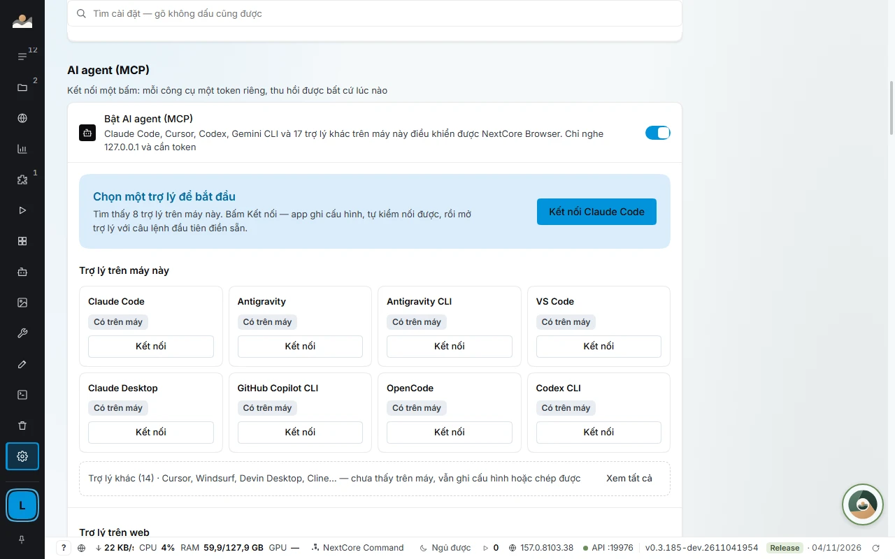

# For developers: Local API, CDP and MCP

[← Back to main page](../../README.en.md) · [Tiếng Việt](../developer.md)

Everything you can click in the app can be controlled by script or by an AI agent. It listens only on your machine, with a token.

## Local API and CDP

```bash
# Mở profile, nhận wsEndpoint cho Playwright
curl -X POST -H "Authorization: Bearer $NCB_TOKEN" \
  http://127.0.0.1:19880/api/v1/profiles/p_7f3a/start
```

```json
{ "pid": 18244, "debugPort": 52144,
  "wsEndpoint": "ws://127.0.0.1:52144/devtools/browser/9c1e…" }
```

- Create, open and close profiles and get the CDP port so **Playwright** or **Puppeteer** can control it like an ordinary browser.
- Listens only on `127.0.0.1`, with a separate token per machine, and rejects requests that come from web pages.



## MCP: let AI agents control many logged-in profiles

The app has a built-in **MCP server** that runs on the Local API itself. An AI assistant connects to `http://127.0.0.1:<port>/mcp` with a token. Nothing is exposed to the Internet.

- **One-click connection** for Claude Code, Cursor, VS Code, Antigravity: the app writes the config file with a separate token for each assistant, then verifies it by calling the tool list exactly as the assistant would. Other MCP clients use the JSON block in the app. One token per assistant, separately revocable.
- **`browser_*` has the same names as the official Playwright MCP,** so an agent that already knows Playwright MCP can use it right away. The agent works on pages **inside each profile**, keeping that profile's logins, proxy and extensions.
- **Agents manage profiles for you:** list, create, edit, open, close, arrange windows into a grid, back up to an encrypted file, check proxies, test for IP, time zone and WebRTC leaks.
- **Operate the whole app:** GROUP CRAWL, CUSTOMERPOST, AUTOMATIONS, MEDIA, accounts, quota, multi-machine terminal, NEXTCORE DESIGN (`ncd_*`).
- **One MCP session per profile.** To run many profiles in parallel, open many sessions. A profile that one session is holding is refused to other sessions, so two agents never step on each other.

### Tool sets by client limits

The full set has nearly 190 tools, which is heavy for assistants that limit the number of tools. Add `?bo=` to the address to choose a smaller set:

| Address | What it has | Use for |
|---|---|---|
| `/mcp` | All tools | Claude Code, Claude Desktop, Antigravity, Gemini CLI, Codex CLI, OpenCode |
| `/mcp?bo=app` | Profile management, sessions, `browser_*`, app operations (127 tools) | VS Code (limit of 128), Cline, Roo Code, Kiro, Continue, Copilot CLI, Zed |
| `/mcp?bo=co-ban` | Profile management, sessions, the 20 most-used `browser_*` tools (about 50 tools) | Cursor, Windsurf, LM Studio |

### What you tell the agent

- «List the profiles in the Shop group with proxy errors.»
- «Create 10 profiles named Shop 01 to Shop 10, assigning these proxies in turn.»
- «Open 4 profiles from the Farm 2 group and arrange them in a 2×2 grid on the second monitor.»
- «Measure this page at four device widths, light and dark, and tell me where text is clipped.»

## Compared with other approaches

| | Playwright MCP only | One Chrome, many profiles | NextCore Browser |
|---|---|---|---|
| Keeps logins between runs | No, a fresh browser every time | Yes | Yes |
| Own proxy per account | No | No, one proxy for the whole browser | Yes, per profile, with proxy checks |
| Agent creates and manages profiles | No | No | Yes, via MCP |
| Many agents on different accounts at once | One browser per server | Cookies easily mix between accounts | Yes, one session per profile |
| Runs only on your machine | Yes | Yes | Yes, MCP listens only on 127.0.0.1 |

## Safety

- Only this machine can call it (`127.0.0.1`), a token is required, and requests from web pages are rejected. Treat the token like a password; if it leaks, change the token or revoke that assistant.
- No tool returns a proxy password. When **Credential masking** is on, the profile list masks account passwords, 2FA, email passwords and cookies. An agent reads a single cell verbatim only through a dedicated command, one cell at a time, and every call is recorded in *Latest calls*.
- Commands that touch the data folder, quit or restart the app can only run on that machine itself.
- Automation on platforms may violate those platforms' terms. Have the agent stop and ask for your approval before public actions (posting, mass messaging, payments).

## Detailed documentation

[Local API](https://docs.homestaynextcore.org/developer/local-api/) · [MCP for AI agents](https://docs.homestaynextcore.org/developer/mcp/) · [NextCore E2E](kernel-e2e.md) · [NEXTCORE DESIGN](design.md)
