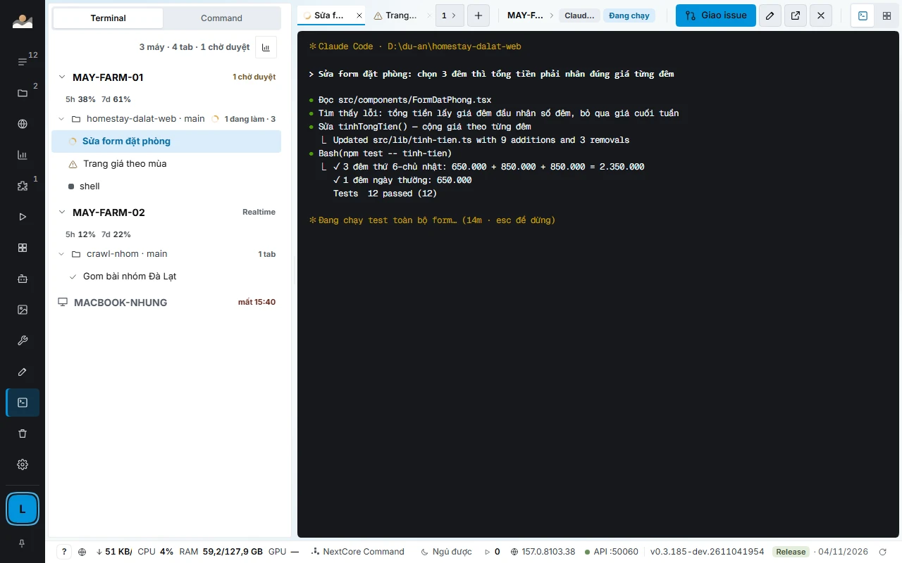
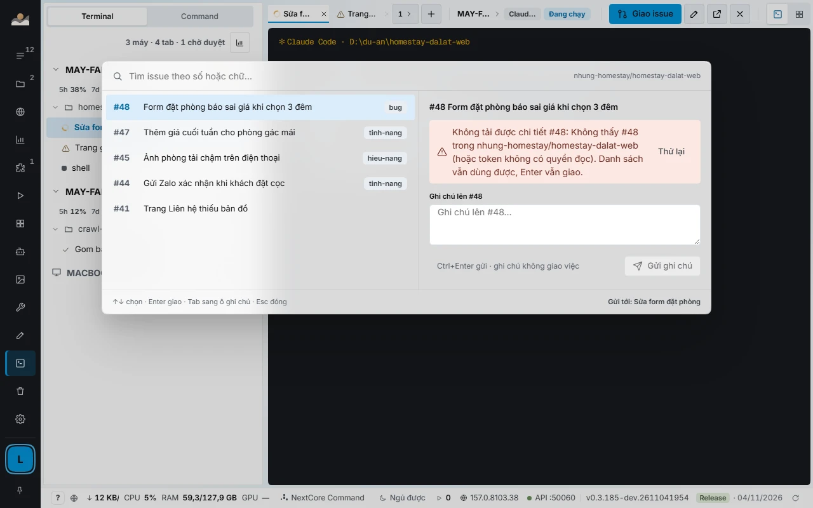
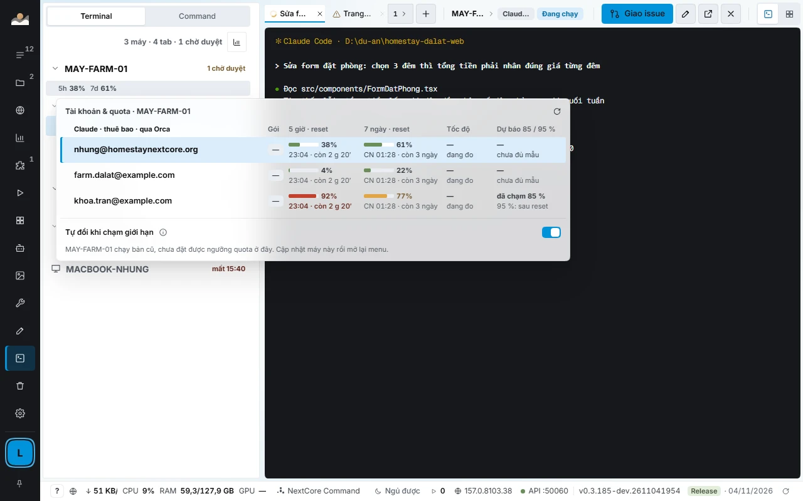
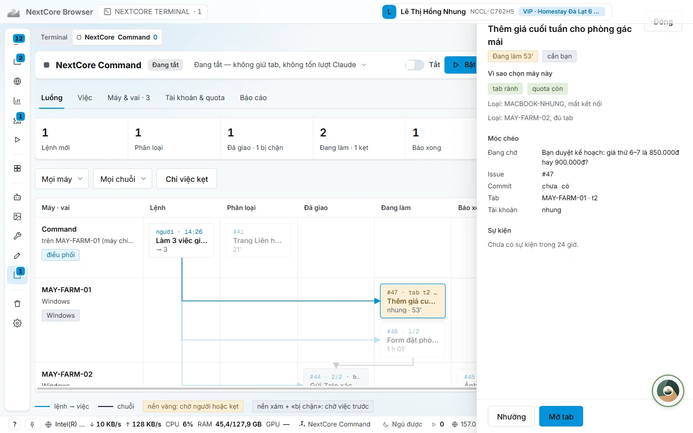
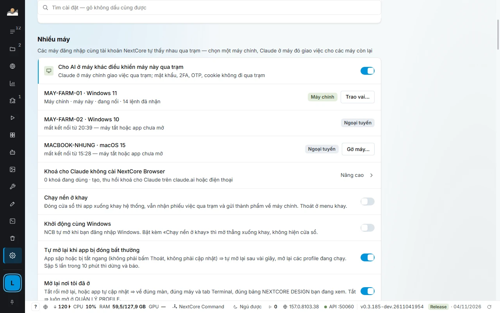

# NEXTCORE TERMINAL, NextCore Command and quota balancing

[← Back to main page](../../README.en.md) · [Tiếng Việt](../terminal-command-quota.md)

If you run AI agents to write code, test or operate, this is the part of NextCore Browser most worth a look. NCB **installs no agent**: it uses the Claude Code, Codex, Gemini and Antigravity you already installed and the plans you already bought, and handles the orchestration around them.

## The problem

| When running agents across many machines | Consequence |
|---|---|
| One terminal window per machine | No idea which machine is doing what, agents stuck waiting for you and nobody sees it |
| Assigning work by typing into each tab | Tedious, and easy to give the same task to two tabs |
| One Claude account runs out of quota midway | The agent stands still until the reset time, even though another account has plenty left |
| A 5-hour window refreshes at only 20% used | 80% of the paid quota is wasted |
| An agent reports «done» with no evidence | You have to re-check every task yourself |

## NEXTCORE TERMINAL: one screen for every tab on every machine

- **Machine tree, worktrees, tabs.** A spinner is an agent working, a check mark is an agent done, a warning icon is a tab waiting for your approval, a moon is a machine asleep.
- **Type into another machine's tab as if it were your own.** Text appears in the frame immediately, without waiting for the other machine to send it back. Typing Vietnamese with Unikey/EVKey keeps the keys in the right order. Keys that fail to reach the tab are not lost silently: a «Keys not delivered» strip appears at the top of the frame, keeps the characters and lets you retry. Pasting images (up to 10 MB) into another machine's tab also works.
- **Assign a GitHub issue with one key** (`Alt+I`): type a number or a few words to filter, press Enter and the tab receives «Work on issue #N: title, link» and starts working. The panel shows the issue content, the task list, the latest commits with CI status, and a note box that posts comments to the issue.
- **Each tab states what it is running:** engine (Claude, AGY, Codex, Gemini), model, reasoning level, account, and remaining quota for the 5-hour and 7-day windows.
- **Split frames, 2×2 grid, drag and drop tabs, detach a tab into its own window.** When you reopen the app, you return to the same machines, tabs and layout.
- **Runs independently.** Since version 0.3.187, new agent tabs run right inside NextCore Browser by default, with no terminal manager to install.
- **Each machine measures its own capacity.** NCB measures each machine's free RAM, CPU and latency, then decides whether that machine accepts more tabs; it always leaves room for you to use the machine. Orphaned `node` processes left after a tab closes are cleaned up every minute.
- **Keep machines awake, wake sleeping ones.** Workstations stay awake on their own while an agent is working; a sleeping machine can be woken over the LAN.
- **Update workstations from the main machine** with one button on the machine card.

## Quota balancing across Claude accounts

Claude plans count quota in 5-hour and 7-day windows. NCB treats **the quota of every account you are signed in to as one shared pool** and orchestrates it:

| When | What NCB does |
|---|---|
| An account's estimated quota is **at 85% or more** | **Drain gradually:** assign no new work to this account, close worker tabs that are done, wait for working tabs to finish their turn, then reopen them on an account with more quota. |
| **At 95% or more** | **Switch immediately**, even for a working tab: Claude continues the same session on the new account. The NextCore Command tab is not closed and reopened. |
| A tab reports hitting its limit for more than 3 minutes | Switch to the account with the most quota and type «continue» into the stuck tab. |
| The account in use has less than 1% left | Switch to the account with the most quota. |
| There are 2 or more accounts | Use the account closest to its refresh time **first**. Quota that is about to reset unused is wasted quota. |
| Quota numbers are stale | Be more conservative and mark them with `~`. An idle account whose numbers are older than 30 minutes is refreshed with one very small query. |
| **Every account is exhausted at once** | NextCore Command **stops itself and records the time it will resume** (reset time plus 3 minutes); at that time it rereads the quota and types «continue» into the stuck tabs. |

- **Estimated from the whole team's burn rate.** Every machine sends each account's quota through the relay every 30 seconds; NCB merges by email, estimates how many % per hour each tab burns, and switches **before** the limit is hit rather than waiting for an error.
- **Usage screen: the shared quota pool.** Four number tiles (how much is left, current pace, forecast of running out, refresh milestone), a 7-day pool chart with the measured line and the plan line, an account table in a "use it or lose it" style, and quota usage history by task, tab and machine. The **Apply plan** button runs one orchestration pass immediately.
- **A quota utilization report with real numbers.** Which account wasted what %, how much % was lost (with tab·hours and the machines that were used), and concrete suggestions: switch an account for one machine, raise the number of tabs, add more tasks. Each suggestion comes with the estimated % of additional quota that could be used. If a number is missing, that sentence is dropped rather than guessed.
- **Fallbacks when the Claude plan runs out.** If the main machine has Antigravity (`agy`), NextCore Command temporarily switches to it and returns to Claude when quota recovers to 20%. For worker tabs, you can turn on running with your own Anthropic API key: **off by default**, with a spending cap of **3 USD per task and 15 USD per day**, the key goes only into that tab's environment variables, and an agent over MCP cannot turn it on, so no agent spends money on your behalf.
- **Three tab groups:** handling work (50%), exploring work worth doing (30%), reserve for acceptance and unblocking (20%). The ratio stretches with the task book, and if no other group has work, the slot is still filled.

> This is balancing across **your own** accounts and plans. NCB adds no quota, uses no one else's accounts, and does not change the provider's limits.

## NextCore Command: one commander for the whole team

Each NextCore account has exactly **one** NextCore Command, placed on the main machine. It is a special agent tab with an orchestration role.

| What it does | What it does not do |
|---|---|
| Reads the worker tab's **Handoff** when work is done or stuck | Write code in place of the worker tab |
| Accepts work: pass, reassign, or write a question for you | Type into a tab you are using |
| Splits big tasks into small ones in the task book; a dependent task is only assigned once the task it waits for is done | Enter OTP codes, pay money, change selling prices or make business decisions for you |
| Writes each decision as one log line for you to reread | Run when you have turned it off or paused it |

- **Does not run continuously.** With no events it sits idle and costs no tokens. Events that arrive close together are grouped into one wake-up.
- **Structured Handoff.** A worker tab submits a Handoff with status, evidence and the unfinished parts already moved into specific tasks; if it reports «done» without evidence, the Check column says «Chưa thật» (not yet verified) and the task is not accepted.
- **The task book has a clock.** Each task records time running, waiting, stuck and idle; the History panel rates it «reasonable» or «off by N×» against the estimated time, with the main cause.
- **Tab watching every minute.** Tabs that stand still, hang on a command, drop an assignment or can no longer run are detected and handled: nudge, resend, close, assign the next task.
- **A broken tab is rebuilt automatically.** If the Command tab is closed, out of session or hits a limit, NCB closes the broken tab and opens a new one; the tasks it tracks and the log live in NCB, so the new tab continues, with nothing lost.
- **Work that needs you asks in the right place.** Sign-ins, verification codes, real money and business decisions are written as questions with a suggested option; Command does not choose for you.
- **Chooses the model by task difficulty**, and downgrades the model when a task is running late.
- **Pin a task to one machine** (needs a specific operating system, needs a logged-in profile), **tasks that wait until a set time**, **tasks that wait for a release**: workstations ask for work on their own when idle.

NextCore Command's decisions are computed by **NextCore Kernel**, see the [dedicated page](kernel-e2e.md).

## Working across multiple machines

Machines on the same NextCore account find each other automatically through the **relay** on the LAN, without opening any port to the Internet. Choose one **main machine**, and the others receive work from it.

- Passwords, 2FA, OTP and cookies **do not pass through the relay**.
- Transfer the main machine role to another machine with one button in Settings.
- If the app crashes or is killed, it reopens itself after a few seconds and reopens the profiles that were running (after 5 crashes in 10 minutes it stops and reports).
- If the main machine loses connection: the relay keeps a copy of the task book so workstations can keep being served.

## Detailed documentation

[NEXTCORE TERMINAL](https://docs.homestaynextcore.org/nextcore-browser/nextcore-terminal/) · [NextCore Command overview](https://docs.homestaynextcore.org/nextcore-browser/tong-quan/) · [Workstations and multiple machines](https://docs.homestaynextcore.org/nextcore-browser/tram-nhieu-may/)
