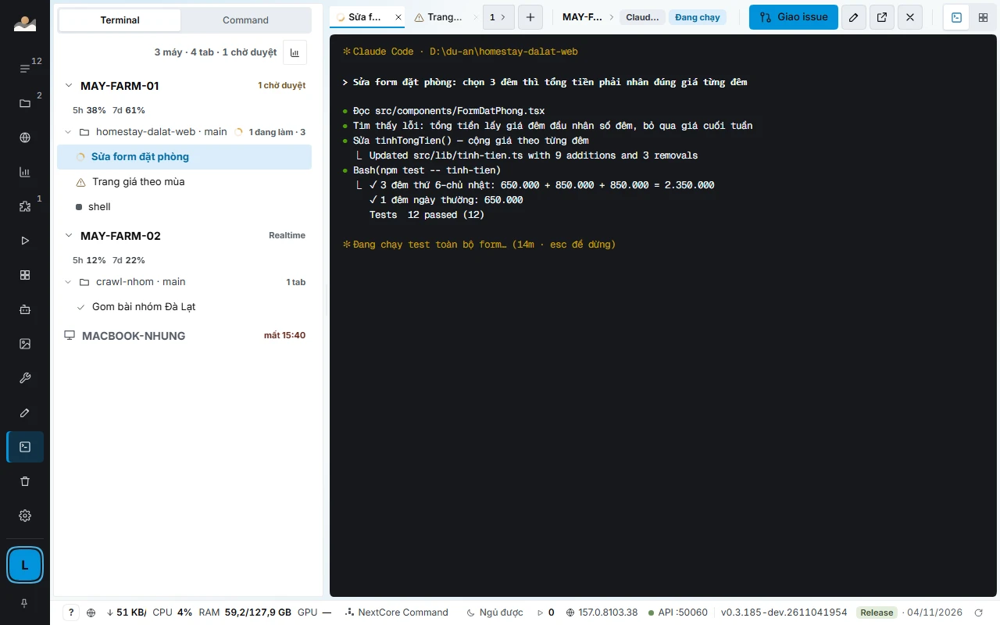
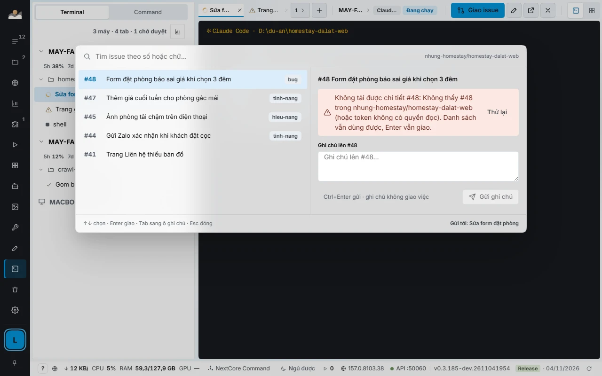
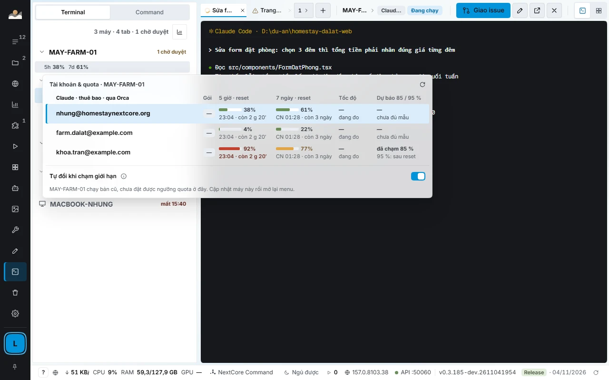
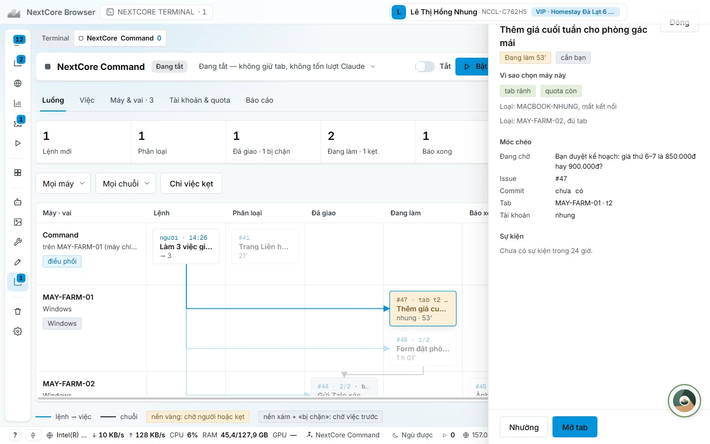
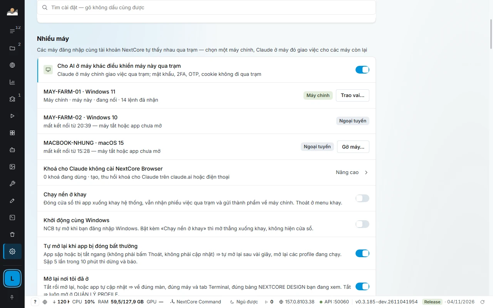

# NEXTCORE TERMINAL, NextCore Command và cân bằng quota

[← Về trang chính](../README.md) · [English](en/terminal-command-quota.md)

Nếu bạn chạy AI agent để viết mã, kiểm thử hay vận hành, đây là phần đáng xem nhất của NextCore Browser. NCB **không cài agent nào**: nó dùng Claude Code, Codex, Gemini, Antigravity bạn đã cài và các gói bạn đã mua, rồi lo phần điều phối quanh chúng.

## Bài toán

| Khi chạy agent ở quy mô nhiều máy | Hậu quả |
|---|---|
| Mỗi máy một cửa sổ terminal riêng | Không biết máy nào đang làm gì, agent kẹt chờ bạn mà không ai thấy |
| Giao việc bằng cách tự gõ vào từng tab | Mất công, dễ giao trùng một việc cho hai tab |
| Một tài khoản Claude cạn quota giữa chừng | Agent đứng im tới giờ reset, dù tài khoản khác còn dư |
| Khung 5 giờ vừa làm mới mà mới dùng 20% | 80% quota đã trả tiền mất trắng |
| Agent báo «xong» mà không kèm bằng chứng | Phải tự kiểm lại từng việc |

## NEXTCORE TERMINAL: một màn hình cho mọi tab trên mọi máy

- **Cây máy, worktree, tab.** Vòng xoay là agent đang làm, dấu tích là agent xong, biểu tượng cảnh báo là tab đang chờ bạn duyệt, mặt trăng là máy đang ngủ.
- **Gõ vào tab của máy khác như gõ trên máy mình.** Chữ hiện ngay trong khung, không chờ máy kia gửi lại. Gõ tiếng Việt bằng Unikey/EVKey đúng thứ tự phím. Phím không tới được tab thì không mất im lặng: đầu khung hiện dải «Phím chưa tới», giữ lại các ký tự và cho thử lại. Dán ảnh (tối đa 10 MB) sang tab của máy khác cũng được.
- **Giao issue GitHub bằng một phím** (`Alt+I`): gõ số hoặc vài chữ để lọc, Enter là tab nhận «Làm issue #N: tiêu đề — link» và bắt đầu làm. Bảng hiện nội dung issue, danh sách việc, commit gần nhất kèm trạng thái CI, và ô ghi chú gửi bình luận lên issue.
- **Mỗi tab nói rõ nó đang chạy gì:** động cơ (Claude, AGY, Codex, Gemini), model, mức suy luận, tài khoản, quota còn lại của khung 5 giờ và 7 ngày.
- **Chia khung, lưới 2×2, kéo thả tab, tách tab ra cửa sổ riêng.** Mở lại app thì về đúng máy, tab, bố cục lúc trước.
- **Chạy độc lập.** Từ bản 0.3.187, tab agent mới mặc định chạy ngay trong NextCore Browser, không cần cài thêm trình quản lý terminal nào.
- **Mỗi máy tự đo sức mình.** NCB đo RAM trống, CPU và độ trễ của từng máy rồi quyết định máy đó nhận thêm tab hay không; luôn chừa phần cho bạn dùng máy. Tiến trình `node` mồ côi sau khi tab đóng được dọn mỗi phút.
- **Giữ máy thức, đánh thức máy ngủ.** Máy trạm tự giữ thức khi còn agent đang làm; máy đang ngủ đánh thức được qua mạng LAN.
- **Cập nhật máy trạm từ máy chính** bằng một nút trên thẻ máy.

## Cân bằng quota giữa các tài khoản Claude

Gói Claude tính quota theo khung 5 giờ và 7 ngày. NCB coi **quota của mọi tài khoản bạn đã đăng nhập là một bể chung** và điều phối nó:

| Khi nào | NCB làm gì |
|---|---|
| Quota ước tính của một tài khoản **từ 85%** | **Xả dần:** không giao việc mới cho tài khoản này, đóng tab thợ đã xong, chờ tab đang làm hết lượt rồi mở lại tab đó trên tài khoản còn nhiều quota. |
| **Từ 95%** | **Đổi ngay**, kể cả tab đang làm: Claude tiếp tục đúng phiên cũ trên tài khoản mới. Tab NextCore Command không bị đóng mở lại. |
| Tab báo chạm giới hạn quá 3 phút | Đổi sang tài khoản còn nhiều quota nhất và gõ «tiếp tục» vào tab đang kẹt. |
| Tài khoản đang dùng còn dưới 1% | Đổi sang tài khoản còn nhiều quota nhất. |
| Có từ 2 tài khoản | Dùng **trước** tài khoản sắp tới giờ làm mới. Quota sắp reset mà chưa dùng là quota bỏ phí. |
| Số quota đã cũ | Tính dè dặt hơn và đánh dấu `~`. Tài khoản rảnh mà số cũ quá 30 phút được làm mới bằng một lượt hỏi rất nhỏ. |
| **Mọi tài khoản cùng cạn** | NextCore Command **tự dừng, ghi giờ sẽ chạy lại** (giờ reset cộng 3 phút), tới giờ đó tự đọc lại quota và gõ «tiếp tục» vào các tab đang kẹt. |

- **Ước tính theo tốc độ đốt của cả đội.** Mọi máy gửi quota từng tài khoản qua trạm mỗi 30 giây; NCB gộp theo email, ước mỗi tab đốt bao nhiêu % mỗi giờ, rồi đổi **trước** khi chạm giới hạn thay vì chờ báo lỗi.
- **Màn Usage: bể quota chung.** Bốn ô số (còn bao nhiêu, nhịp đang dùng, dự báo lúc cạn, mốc làm mới), biểu đồ bể 7 ngày với đường đã đo và đường kế hoạch, bảng tài khoản kiểu «dùng hay mất», lịch sử dùng quota theo việc, tab, máy. Nút **Áp kế hoạch** chạy ngay một lượt điều phối.
- **Báo cáo khai thác quota bằng số thật.** Tài khoản nào hao dùng bao nhiêu %, thất thoát bao nhiêu % (kèm tab·giờ và những máy đã dùng), và đề xuất cụ thể: đổi tài khoản cho một máy, nâng số tab, nạp thêm việc. Mỗi đề xuất kèm % quota ước dùng thêm được. Thiếu số nào thì câu đó bị bỏ, không đoán.
- **Dự phòng khi gói Claude cạn.** Nếu máy chính có Antigravity (`agy`), NextCore Command chuyển tạm sang đó và trả về Claude khi quota hồi từ 20%. Với tab thợ, bạn có thể bật chạy bằng khoá Anthropic API của chính mình: **mặc định tắt**, có trần chi **3 USD mỗi việc và 15 USD mỗi ngày**, khoá chỉ đi vào biến môi trường của tab đó, và agent qua MCP không bật được, nên không agent nào tự chi tiền thay bạn.
- **Ba nhóm tab:** xử lý việc (50%), khám phá việc đáng làm (30%), dự phòng để nghiệm thu và gỡ kẹt (20%). Tỉ lệ co giãn theo sổ việc, và không nhóm nào khác có việc thì chỗ vẫn được lấp.

> Đây là cân bằng giữa các tài khoản và gói **của chính bạn**. NCB không thêm quota, không dùng tài khoản của người khác, và không thay đổi giới hạn của nhà cung cấp.

## NextCore Command: một chỉ huy cho cả đội

Mỗi tài khoản NextCore có đúng **một** NextCore Command, đặt ở máy chính. Nó là tab agent đặc biệt có vai điều phối.

| Nó làm | Nó không làm |
|---|---|
| Đọc **Bàn giao** của tab thợ khi việc xong hoặc kẹt | Tự viết code thay tab thợ |
| Nghiệm thu: đạt, giao lại, hoặc ghi câu hỏi cho bạn | Gõ vào tab bạn đang dùng |
| Chia việc lớn thành việc nhỏ trong sổ việc; việc phụ thuộc chỉ được giao khi việc nó chờ đã xong | Nhập mã OTP, trả tiền, đổi giá bán hay quyết định kinh doanh thay bạn |
| Ghi mỗi quyết định thành một dòng nhật ký để bạn đọc lại | Chạy khi bạn đã tắt hoặc tạm dừng |

- **Không chạy liên tục.** Không có sự kiện thì nó ngồi yên và không tốn token. Sự kiện đến sát nhau được gom vào một lần đánh thức.
- **Bàn giao có cấu trúc.** Tab thợ nộp Bàn giao có trạng thái, bằng chứng và phần chưa xong đã chuyển sang việc cụ thể; báo «xong» mà thiếu bằng chứng thì cột Kiểm ghi «Chưa thật» và việc không được nghiệm thu.
- **Sổ việc có đồng hồ.** Mỗi việc ghi thời gian chạy, chờ, kẹt, rảnh; bảng Lịch sử chấm «hợp lý» hay «lệch N×» so với thời gian ước, kèm nguyên nhân chính.
- **Canh tab mỗi phút.** Tab đứng im, treo lệnh, rơi lời giao hay hết chạy được phát hiện và xử lý: nhắc, gửi lại, đóng, giao việc kế.
- **Tab hỏng thì tự dựng lại.** Tab Command bị đóng, hết phiên hay chạm giới hạn: NCB đóng tab hỏng và mở tab mới; việc đang theo dõi và nhật ký nằm trong NCB nên tab mới làm tiếp, không mất gì.
- **Việc cần bạn thì hỏi đúng chỗ.** Đăng nhập, mã xác thực, tiền thật, quyết định kinh doanh được ghi thành câu hỏi kèm phương án đề xuất; Command không tự chọn thay bạn.
- **Chọn model theo độ khó của việc**, hạ model khi việc đang trễ.
- **Ghim việc vào một máy** (cần hệ điều hành riêng, cần profile đã đăng nhập), **việc chờ tới một giờ cố định**, **việc chờ bản phát hành**: máy trạm tự xin việc khi rảnh.

Quyết định của NextCore Command được tính bởi **NextCore Kernel**, xem [trang riêng](kernel-e2e.md).

## Làm việc nhiều máy

Các máy cùng tài khoản NextCore tự thấy nhau qua **trạm** trong mạng LAN, không mở cổng ra Internet. Chọn một **máy chính**, các máy còn lại nhận việc từ máy chính.

- Mật khẩu, 2FA, OTP và cookie **không đi qua trạm**.
- Trao vai máy chính sang máy khác bằng một nút trong Cài đặt.
- App sập hoặc bị tắt ngang thì tự mở lại sau vài giây, mở lại các profile đang chạy (sập 5 lần trong 10 phút thì dừng và báo).
- Máy chính mất kết nối: trạm giữ bản sao sổ việc để máy trạm tiếp tục được phục vụ.

## Tài liệu chi tiết

[NEXTCORE TERMINAL](https://docs.homestaynextcore.org/nextcore-browser/nextcore-terminal/) · [Tổng quan NextCore Command](https://docs.homestaynextcore.org/nextcore-browser/tong-quan/) · [Máy trạm và nhiều máy](https://docs.homestaynextcore.org/nextcore-browser/tram-nhieu-may/)
