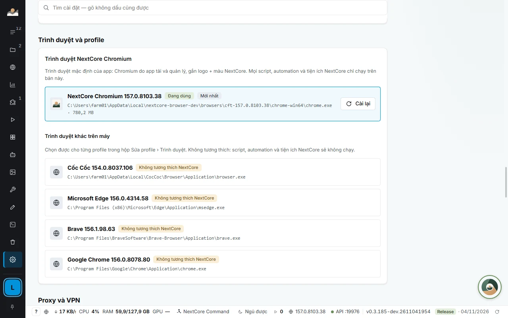
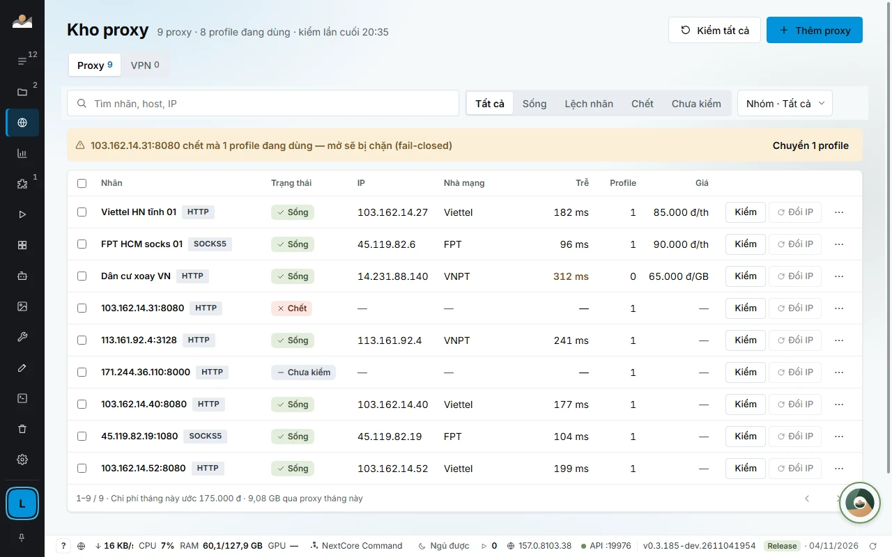
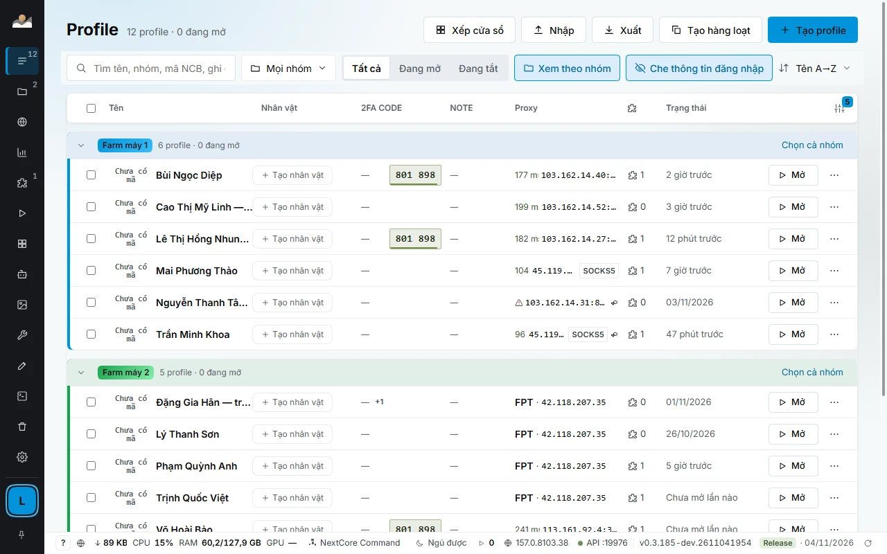

# NextCore Chromium, vân tay và cách ly profile

[← Về trang chính](../README.md) · [English](en/browser-fingerprint.md)

Đây là nền của NextCore Browser: mỗi tài khoản chạy trong một trình duyệt tách biệt, có danh tính trình duyệt ổn định và đường mạng riêng.

## Vì sao cần cách ly từng profile

Một Chrome dùng chung cho nhiều tài khoản thì cookie, bộ nhớ trang và tiện ích lẫn nhau, mọi tài khoản đi chung một đường mạng và chung một dấu vết trình duyệt. Hồ sơ Chrome tách được dữ liệu nhưng vẫn chạy trên cùng một máy với cùng một cấu hình phần cứng và cùng một proxy.

NextCore Browser tách ba lớp cùng lúc:

| Lớp | Tách bằng gì |
|---|---|
| **Dữ liệu** | Mỗi profile một thư mục dữ liệu Chromium riêng: cookie, đăng nhập, Local Storage, IndexedDB, dữ liệu tiện ích. Cookie của profile này không bao giờ lọt sang profile khác. |
| **Mạng** | Mỗi profile một proxy riêng (hoặc một node VPN riêng), có kiểm sống chết và đo độ trễ. |
| **Danh tính trình duyệt** | Mỗi profile một bộ vân tay riêng, ổn định giữa các lần mở. |

## NextCore Chromium

Mọi profile mặc định chạy **NextCore Chromium**: bản Chromium chính thức dành cho tự động hoá (Chrome for Testing) do app tự tải và quản lý, rồi gắn nhận diện NextCore.

- **Do app quản lý.** Lần đầu mở profile, app tự tải bản ổn định mới nhất (khoảng 170 MB, một lần). Cập nhật, cài lại và xoá bản cũ ngay trong *SETTINGS › Trình duyệt và profile*. Sau khi cập nhật, bản trước còn trên máy để lùi được.
- **Nhận diện NextCore.** Logo NextCore trên biểu tượng tệp, góc cửa sổ và thanh tác vụ (macOS: Dock, Finder, thanh menu), màu chủ đề xanh NextCore cho thanh tab và thanh địa chỉ. Màu bạn đã tự đổi được giữ nguyên.
- **Sẵn sàng để điều khiển.** Nạp được tiện ích NextCore, có cổng CDP cho Local API, kịch bản tự động hoá và xếp cửa sổ. Mọi script, kịch bản và tiện ích NextCore chỉ chạy trên bản này.
- **Trình duyệt khác chỉ là lựa chọn phụ.** App liệt kê Chrome, Edge, Brave, Cốc Cốc, Firefox đã cài trên máy, mỗi cái gắn nhãn *Không tương thích NextCore*. Profile mở bằng chúng sẽ không chạy kịch bản và tiện ích NextCore, hộp sửa cảnh báo ngay.

## Vân tay trình duyệt

Mỗi profile nhận một **hạt giống** riêng ngay khi tạo. Từ hạt giống đó suy ra cấu hình mà trang web đọc được, nên lần mở nào cũng giống lần trước:

| Thuộc tính | Cách xử lý |
|---|---|
| Màn hình, card đồ hoạ, số nhân CPU, RAM | Suy ra từ hạt giống, chỉ dùng cấu hình có thật trên hệ điều hành đó |
| Canvas, WebGL, âm thanh, phông chữ | Suy ra từ hạt giống, ổn định giữa các lần mở |
| Múi giờ, ngôn ngữ, vị trí | Khớp IP của proxy, lấy từ lần kiểm gần nhất |
| User-Agent và Client Hints | Khớp đúng bản Chromium đang chạy |

Vân tay được đặt xong **trước khi trang chạy dòng script đầu tiên**, ở cả tab mới, cửa sổ popup và iframe.

- **Hai profile trên cùng một máy trông như hai máy khác nhau.** Ví dụ một profile báo 1920×1080, 8 nhân, RTX 3060; profile kia báo 1536×864, 12 nhân, Intel UHD 770, mỗi profile giữ nguyên hạt giống qua các lần mở.
- **Giữ nguyên cả khi sao lưu sang máy khác.** Tệp `.ncbak` mang theo vân tay cùng đăng nhập.
- **Đổi vân tay khi cần.** Nút *Đổi vân tay* cấp hạt giống mới. Nhân bản profile mang theo dữ liệu trình duyệt (cookie, Local Storage, IndexedDB, dữ liệu tiện ích) nên vẫn đăng nhập như bản gốc, còn vân tay được tạo mới.

## Proxy, VPN và định tuyến

- **Proxy theo từng profile:** HTTP, HTTPS, SOCKS4, SOCKS5, có hoặc không mật khẩu. Dòng proxy hiện nhà mạng, IP và độ trễ của lần kiểm gần nhất. Proxy hỏng báo đỏ ngay trên hàng, kèm lý do.
- **Kho proxy dùng chung:** một proxy gán cho nhiều profile, đổi một chỗ là đổi hết. Màn *Lưu lượng proxy* cộng GB và tiền theo kỳ, biết profile nào tiêu nhiều, đặt ngân sách.
- **Định tuyến theo tên miền:** bộ luật tiết kiệm GB, chặn quảng cáo, luật riêng từng trang.
- **Kho VPN theo từng profile:** mỗi profile đi qua một node riêng. **Node không ra mạng thì profile không mở**, nên IP thật của máy không lộ.
- **Đo rò rỉ:** agent qua MCP có công cụ đo rò rỉ IP, múi giờ và WebRTC của profile.

## Quản lý số lượng lớn

- **Thao tác hàng loạt:** chọn 5 hay 50 profile (Shift + bấm chọn cả đoạn) rồi mở, đóng, gán proxy, đặt nhóm hoặc xoá trong một lượt. Tạo hàng loạt từ danh sách, nhập và xuất danh sách profile.
- **Xếp cửa sổ:** chọn màn hình đích, app gợi ý lưới vừa nhất theo số cửa sổ đang mở, kể cả màn xoay dọc. Thu phóng trang từ 25% tới 200% để nhìn nhiều tài khoản cùng lúc.
- **Mã 2FA trên hàng profile:** mã 6 số, đổi màu khi sắp hết 30 giây, bấm là chép. Khoá không rời máy.
- **Sao lưu `.ncbak`:** mã hoá AES-256, mang sang máy khác vẫn giữ đăng nhập. Tệp hỏng một byte là từ chối khôi phục.
- **Che thông tin đăng nhập:** công tắc che mật khẩu tài khoản, 2FA, mật khẩu email và cookie trên danh sách; agent chỉ đọc nguyên văn một ô qua lệnh riêng, từng ô một, mỗi lần gọi đều được ghi lại.

## Dùng có trách nhiệm

NextCore Browser là công cụ quản lý nhiều tài khoản và tự động hoá. Tự động hoá trên các nền tảng (Facebook và các trang khác) có thể vi phạm điều khoản của nền tảng đó. Bạn chịu trách nhiệm tuân thủ điều khoản của các trang bạn dùng. Với agent, nên để agent dừng lại xin bạn duyệt trước các hành động công khai như đăng bài, nhắn tin hàng loạt hay thanh toán.

## Tài liệu chi tiết

[Profile và proxy](https://docs.homestaynextcore.org/nextcore-browser/profile/) · [Trình duyệt và phiên bản](https://docs.homestaynextcore.org/nextcore-browser/trinh-duyet-phien-ban/) · [Kho proxy](https://docs.homestaynextcore.org/nextcore-browser/proxy/) · [Mã 2FA](https://docs.homestaynextcore.org/nextcore-browser/ma-2fa/) · [Sao lưu và khôi phục](https://docs.homestaynextcore.org/nextcore-browser/sao-luu-khoi-phuc/)
